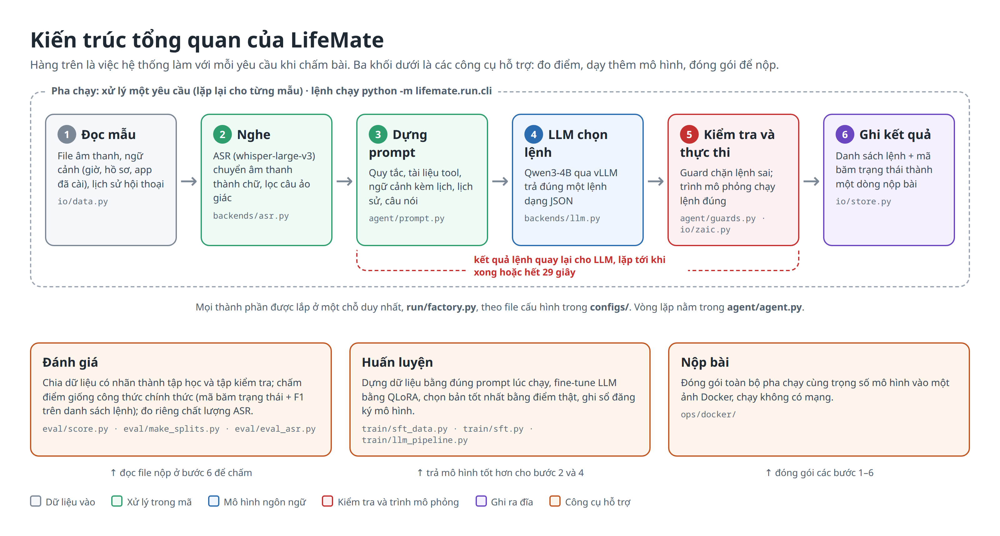
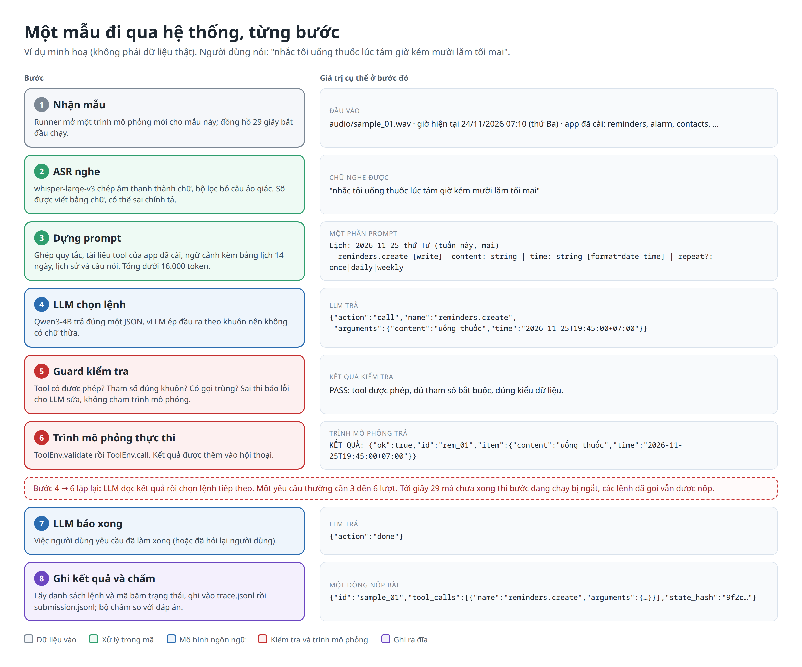

# LifeMate

LifeMate là trợ lý giọng nói tiếng Việt chạy hoàn toàn ngoại tuyến. Hệ thống nghe một yêu cầu bằng giọng nói (ví dụ "nhắc tôi uống thuốc lúc tám giờ tối mai"), hiểu người dùng muốn gì, rồi gọi đúng chuỗi lệnh (tool call) trên một bộ ứng dụng mô phỏng. Kết quả được chấm theo trạng thái cuối của các ứng dụng và độ khớp của danh sách lệnh, không chấm câu trả lời bằng lời.

Ràng buộc chính: một mô hình ngôn ngữ (LLM) dưới 5 tỷ tham số cộng một mô hình nhận dạng giọng nói (ASR), tổng dưới 6 tỷ tham số, chạy trên một GPU, mỗi yêu cầu xong trong 30 giây, không có mạng.

## Mục lục

- [1. Bắt đầu nhanh](#1-bắt-đầu-nhanh)
   - [1.1. Cần chuẩn bị](#11-cần-chuẩn-bị)
   - [1.2. Đặt dữ liệu](#12-đặt-dữ-liệu)
   - [1.3. Kiểm tra và chạy thử](#13-kiểm-tra-và-chạy-thử)
   - [1.4. Xem kết quả](#14-xem-kết-quả)
- [2. Cấu trúc repo](#2-cấu-trúc-repo)
- [3. Kiến trúc tổng quan](#3-kiến-trúc-tổng-quan)
- [4. Một mẫu dữ liệu đi qua pipeline](#4-một-mẫu-dữ-liệu-đi-qua-pipeline)
- [5. Chức năng bổ trợ](#5-chức-năng-bổ-trợ)
   - [5.1. Profile cho từng loại máy](#51-profile-cho-từng-loại-máy)
   - [5.2. Kaggle](#52-kaggle)
   - [5.3. Colab](#53-colab)
   - [5.4. Thuê GPU (RunPod hoặc máy khác)](#54-thuê-gpu-runpod-hoặc-máy-khác)
   - [5.5. Đóng gói](#55-đóng-gói)
   - [5.6. Lưu trữ dữ liệu và kết quả](#56-lưu-trữ-dữ-liệu-và-kết-quả)
- [6. Thuật ngữ](#6-thuật-ngữ)
- [7. Đọc thêm](#7-đọc-thêm)

## 1. Bắt đầu nhanh

### 1.1. Cần chuẩn bị

- Python 3.11 và [`uv`](https://docs.astral.sh/uv/) (công cụ cài thư viện theo đúng phiên bản trong `uv.lock`).
- Dữ liệu thi (không có trong repo, xem mục 1.2).
- GPU NVIDIA chỉ cần khi chạy mô hình thật hoặc huấn luyện. Kiểm thử và chạy với mô hình giả không cần GPU.

```bash
git clone https://github.com/awun0105/JSON-lifemate.git
cd JSON-lifemate
make install        # cài thư viện, không có vLLM (máy không GPU)
make install-gpu    # hoặc: cài thêm vLLM (máy có GPU)
```

### 1.2. Đặt dữ liệu

Giải nén dữ liệu thi vào `data/` sao cho có đúng cấu trúc dưới đây. Thư mục `data/` đã được khai báo trong `.gitignore`, nên dữ liệu không bao giờ bị đưa lên git.

```
data/train+public_test/
├── train/
│   ├── train.jsonl                  các mẫu có nhãn
│   ├── train_tools_catalog.json     danh mục tool của tập train
│   ├── audio/                       file âm thanh .wav
│   ├── train_environment/           trạng thái ban đầu của các ứng dụng (chỉ trình mô phỏng được đọc)
│   └── zaic_tools/                  trình mô phỏng ứng dụng đi kèm tập train
└── public_test/
    └── ...                          cùng cấu trúc, không có nhãn
```

### 1.3. Kiểm tra và chạy thử

```bash
make check          # ruff + mypy --strict
make test           # toàn bộ test, chạy trên CPU
make splits         # sinh danh sách id các tập vào configs/splits/ (không có trong git, cần dữ liệu thi)

# Chạy cả hệ thống với mô hình giả (không cần GPU); kết quả đúng phải là 100 điểm
make run CONFIG=configs/fake.toml IDS=configs/splits/smoke.txt

# Chạy với mô hình thật (cần GPU và make install-gpu); lần đầu tự tải mô hình từ Hugging Face
make run IDS=configs/splits/smoke.txt
```

`make run` nhận các biến: `CONFIG` (mặc định `configs/v0.toml`), `ENV` (profile máy, mặc định `local`), `SPLIT` (mặc định `train`), `IDS` (file danh sách id), `NAME` (tên lần chạy).

### 1.4. Xem kết quả

Mỗi lần chạy tạo một thư mục `artifacts/runs/<tên>/`:

| File | Nội dung |
|---|---|
| `score.txt` | Điểm, điểm theo loại đáp án, ma trận quyết định, loại lỗi, điểm theo từng app |
| `summary.json` | Lý do dừng, thời gian p50/p95/max mỗi mẫu, số token, điểm |
| `trace.jsonl` | Nhật ký từng mẫu: chữ ASR nghe được, từng bước LLM, lệnh đã gọi, kết quả, lỗi |
| `submission.jsonl` | File nộp bài: mỗi mẫu một dòng `id`, `tool_calls`, `state_hash` |
| `config.json` | Cấu hình đã dùng, commit, GPU, kiểu số thực tế |

```bash
make report                                                          # bảng mọi lần chạy, mới nhất trên cùng
make score SUB=artifacts/runs/<tên>/submission.jsonl IDS=configs/splits/val_seen.txt   # chấm lại một file nộp
```

## 2. Cấu trúc repo

Chỉ liệt kê các thư mục có trong git. Mỗi thư mục có README riêng mô tả từng file bên trong.

```
JSON-lifemate/
├── lifemate/          Mã nguồn: gói Python chính, chia thành 7 gói con
│   ├── core/          Kiểu dữ liệu, cấu hình, tiện ích dùng chung; không phụ thuộc gói nào khác
│   ├── agent/         Vòng lặp agent: dựng prompt, gọi LLM, kiểm tra lệnh, hạn giờ
│   ├── backends/      Mô hình: LLM (vLLM) và ASR (whisper-large-v3 qua faster-whisper và các engine khác)
│   ├── io/            Đọc dữ liệu, mở trình mô phỏng, ghi kết quả lần chạy
│   ├── run/           Lắp ghép hệ thống, dòng lệnh, chạy từng mẫu, báo cáo
│   ├── eval/          Chấm điểm, chia dữ liệu, đo chất lượng ASR
│   └── train/         Dựng dữ liệu và fine-tune LLM, ASR
├── tests/             Bộ kiểm thử pytest, chạy trên CPU, không cần GPU
├── configs/           Cấu hình chạy, profile từng loại máy, prompt, danh sách chia dữ liệu, cấu hình huấn luyện
├── ops/               Vận hành: Docker, kernel Kaggle, notebook, script cài đặt và đóng gói
├── docs/              Tài liệu: đặc tả, lý do thiết kế, phân tích dữ liệu, sơ đồ, slide
├── artifacts/models/  Sổ đăng ký các mô hình đã huấn luyện (chỉ file registry, không có trọng số)
├── AGENTS.md          Thứ tự đọc tài liệu và các luật bắt buộc cho người mới
├── Makefile           Các lệnh thường dùng
├── pyproject.toml     Khai báo gói, thư viện, cấu hình ruff, mypy, pytest
└── uv.lock            Phiên bản cố định của mọi thư viện
```

Nằm ngoài git (khai báo trong `.gitignore`):

- `data/`: dữ liệu thi. Đây là dữ liệu riêng tư, không bao giờ được đưa lên git.
- `artifacts/runs/`, `artifacts/dist/`, `artifacts/models/llm/`, `artifacts/models/asr/`: kết quả chạy, gói mã nén và trọng số mô hình, đều sinh lại hoặc tải lại được.

## 3. Kiến trúc tổng quan



**Hàng trên là pha chạy**, tức việc hệ thống làm với mỗi yêu cầu khi chấm bài, theo sáu bước:

1. **Đọc mẫu:** file âm thanh, ngữ cảnh và lịch sử hội thoại.
2. **Nghe:** ASR chuyển âm thanh thành chữ.
3. **Dựng prompt** cho LLM.
4. **LLM chọn một lệnh** dạng JSON.
5. **Kiểm tra và thực thi:** guard chặn lệnh sai, trình mô phỏng chạy lệnh đúng.
6. **Ghi kết quả** thành một dòng nộp bài.

Bước 4 và 5 lặp lại (đường đứt màu đỏ): kết quả của lệnh quay lại cho LLM để chọn lệnh tiếp theo, tới khi xong hoặc hết 29 giây. Dòng chữ nhỏ dưới mỗi ô là file mã làm bước đó.

**Ba khối dưới là công cụ hỗ trợ**, dùng chung mã với pha chạy:

- **Đánh giá:** chấm file nộp ở bước 6 theo công thức chính thức.
- **Huấn luyện:** fine-tune để có mô hình tốt hơn cho bước 2 và bước 4.
- **Nộp bài:** đóng gói cả sáu bước cùng trọng số mô hình vào ảnh Docker.

Mọi thành phần được lắp ở một chỗ duy nhất là `lifemate/run/factory.py`, theo file cấu hình trong `configs/`. Các gói mã chỉ phụ thuộc theo một chiều, từ `run` xuống `core`.

## 4. Một mẫu dữ liệu đi qua pipeline



Cột trái là việc làm ở mỗi bước, cột phải là giá trị cụ thể ở bước đó cho câu "nhắc tôi uống thuốc lúc tám giờ kém mười lăm tối mai". Đây là ví dụ minh hoạ, không phải dữ liệu thật.

Ba điểm cần nhớ:

- **Chữ ASR có thể khác chữ chuẩn.** ASR viết số bằng chữ ("tám giờ kém mười lăm"), còn LLM tự đổi ra giờ cụ thể (19:45). Ngày "mai" được tra từ bảng lịch có sẵn trong prompt, nên LLM không phải tự đếm ngày.
- **Mọi lệnh đều đi qua guard rồi mới tới trình mô phỏng.** Trình mô phỏng ghi lại mọi lệnh nhận được, kể cả lệnh sai, và lệnh sai bị trừ điểm. Vì vậy lệnh sai phải bị chặn trước khi tới đó.
- **Mỗi mẫu có trình mô phỏng mới và đồng hồ 29 giây riêng.** Hết giờ thì bước đang chạy bị ngắt, nhưng các lệnh đã gọi vẫn được nộp.

## 5. Chức năng bổ trợ

### 5.1. Profile cho từng loại máy

Mọi khác biệt giữa các nơi chạy nằm trong `configs/env/<tên>.toml` và được chọn bằng `ENV=<tên>` (hoặc `--env <tên>`): `local`, `kaggle`, `colab`, `runpod`, `rented`, `docker`. Mỗi profile ghi dữ liệu ở đâu (`data_root`), kết quả lưu ở đâu (`runs_dir`), tải mô hình về đâu (`hf_cache`) và lấy HF token từ đâu (`hf_token_source`). Mã không chứa đường dẫn gắn cứng.

### 5.2. Kaggle

1. Tải dữ liệu lên một **dataset riêng tư** (mặc định Kaggle CLI tạo dataset riêng tư; không thêm `--public`):

   ```bash
   mkdir -p data/_kaggle_upload && cp -al "data/train+public_test" data/_kaggle_upload/
   echo '{"title": "<tên-dataset>", "id": "<tài-khoản-kaggle>/<tên-dataset>", "licenses": [{"name": "other"}]}' > data/_kaggle_upload/dataset-metadata.json
   kaggle datasets create -p data/_kaggle_upload --dir-mode zip
   ```

2. Kernel tự động trong `ops/kaggle/` clone mã từ GitHub theo một nhánh hoặc tag, cài vLLM, chạy test, chạy agent, chấm điểm và trả về toàn bộ trace:
   - `ops/kaggle/smoke/`: chạy thử 30 mẫu, so chất lượng ASR ở float32 và float16.
   - `ops/kaggle/eval/`: vòng chỉnh prompt, 274 mẫu `val_seen` với chữ ASR.

   Các file trong `configs/splits/` không có trong git. Kernel tự sinh lại bằng `make_splits` từ dữ liệu đã gắn, kết quả giống hệt bản trên máy phát triển.

   Hai kernel đang khai báo theo tài khoản của tác giả. Người khác cần sửa `id` trong `kernel-metadata.json` và tên dataset trong `dataset_sources` cho khớp tài khoản đang dùng, rồi chạy:

   ```bash
   kaggle kernels push -p ops/kaggle/smoke --accelerator NvidiaTeslaT4
   kaggle kernels status <tài-khoản>/lifemate-smoke
   kaggle kernels output <tài-khoản>/lifemate-smoke -p <thư-mục-kết-quả>
   ```

3. Notebook chạy tay `ops/notebooks/kaggle_*.ipynb` (chạy agent, fine-tune LLM, fine-tune ASR) dùng gói mã nén từ `make pack` (mục 5.5). Profile: `configs/env/kaggle.toml`.

### 5.3. Colab

`ops/notebooks/colab_*.ipynb` giống bản Kaggle nhưng đọc dữ liệu và lưu kết quả trên Google Drive. HF token đặt trong Colab userdata. Profile: `configs/env/colab.toml`.

### 5.4. Thuê GPU (RunPod hoặc máy khác)

```bash
curl -fsSL https://raw.githubusercontent.com/awun0105/JSON-lifemate/main/ops/scripts/runpod_setup.sh \
  | bash -s -- --repo https://github.com/awun0105/JSON-lifemate.git --ref main
```

Script cài `uv`, clone mã vào `/workspace`, cài thư viện có vLLM, tải hai mô hình theo đúng phiên bản ghim, kiểm tra dữ liệu, chạy test và 30 mẫu thử. Dữ liệu cần được tải lên `/workspace/zac2026/train+public_test/` trước (ví dụ bằng `runpodctl send`). Chi tiết ở `docs/runpod.md`. Profile: `configs/env/runpod.toml` (RunPod) và `configs/env/rented.toml` (máy thuê khác).

### 5.5. Đóng gói

**Mã cho notebook:** `make pack` tạo `artifacts/dist/lifemate-code-<commit>.zip` gồm `lifemate/`, `configs/`, `ops/requirements/`, `tests/` và file `VERSION` ghi commit. Tải file zip này lên Kaggle hoặc Colab làm dataset riêng tư.

**Ảnh Docker để nộp bài.** Ảnh phải chứa sẵn trọng số vì lúc chấm không có mạng:

```bash
# 1. Tải trọng số hai mô hình đúng phiên bản ghim trong configs/v0.toml vào artifacts/models/
uv run --with "huggingface_hub[cli]" hf download Qwen/Qwen3-4B-Instruct-2507 \
  --revision cdbee75f17c01a7cc42f958dc650907174af0554 --local-dir artifacts/models/llm
uv run --with "huggingface_hub[cli]" hf download Systran/faster-whisper-large-v3 \
  --revision edaa852ec7e145841d8ffdb056a99866b5f0a478 --local-dir artifacts/models/asr

# 2. Build và chạy thử giống cách chấm (cần Docker và NVIDIA Container Toolkit)
make docker-build
make docker-run DATA_SPLIT_DIR=data/train+public_test/public_test   # kết quả ở result/submission.jsonl
```

Chi tiết ở `docs/docker.md`. Phần lớn máy thuê RunPod không chạy được Docker bên trong pod, nên cần build ở một máy GPU có Docker.

### 5.6. Lưu trữ dữ liệu và kết quả

| Thứ | Nơi lưu | Trong git |
|---|---|---|
| Dữ liệu thi | `data/train+public_test/`; hoặc dataset riêng tư trên Kaggle, Google Drive, ổ `/workspace` trên RunPod | Không |
| Kết quả mỗi lần chạy | `artifacts/runs/<tên>/` (mục 1.4) | Không |
| Bảng tổng hợp các lần chạy | `artifacts/runs/index.csv`, xem bằng `make report` | Không |
| Trọng số mô hình | `artifacts/models/llm/`, `artifacts/models/asr/` trên máy; bản đã fine-tune lưu trên Kaggle Models hoặc HF riêng tư | Không |
| Sổ đăng ký mô hình đã fine-tune | `artifacts/models/registry.csv` | Có |

Kết quả trên Kaggle được giữ lại bằng cách lưu thành phiên bản mới của một dataset riêng tư; trên Colab là Google Drive; trên RunPod là ổ `/workspace` (ổ duy nhất còn lại sau khi tắt pod). Cách lưu này được chọn qua trường `persist` của profile.

## 6. Thuật ngữ

| Thuật ngữ | Nghĩa |
|---|---|
| Tool call | Một lần gọi một chức năng của ứng dụng, giống bấm một nút, gồm tên tool và tham số. |
| Trình mô phỏng, `ToolEnv` | Bộ ứng dụng giả đi kèm dữ liệu. Nhận tool call, thay đổi trạng thái ứng dụng, trả kết quả. |
| Mã băm trạng thái (`state_hash`) | Chuỗi ký tự tóm tắt trạng thái cuối của mọi ứng dụng. Hai trạng thái giống hệt nhau thì mã băm giống hệt nhau. |
| Guard | Bộ kiểm tra chạy trước mỗi tool call, chặn lệnh sai trước khi chạm vào trình mô phỏng. |
| Trace | Nhật ký chi tiết của từng mẫu trong một lần chạy (`trace.jsonl`). |
| Profile | File cấu hình theo loại máy trong `configs/env/`. |
| Split | Một tập dữ liệu: `train`, `public_test`, hoặc tập con chia từ train (`val_seen`, `val_unseen`, `smoke`). |
| QLoRA | Cách fine-tune tiết kiệm bộ nhớ: nén mô hình gốc xuống 4 bit và chỉ học thêm một lớp nhỏ gắn bên cạnh. |
| p50, p95 | Mốc thời gian mà 50% (hoặc 95%) số mẫu chạy không vượt quá. |

## 7. Đọc thêm

- `AGENTS.md`: thứ tự đọc tài liệu và các luật bắt buộc.
- `docs/SPEC.md`: đặc tả chi tiết, nguồn sự thật cho mã.
- `docs/approach.md`: lý do của từng quyết định, nhật ký thí nghiệm.
- `docs/CONTRIBUTING.md`: quy ước viết mã.
- `docs/docker.md`, `docs/runpod.md`: chạy trên GPU và đóng gói.
