# Pipeline ASR hiện tại

Chuỗi xử lý của `MergedASR` ([`lifemate/backends/asr_merged.py`](../../lifemate/backends/asr_merged.py)) cho một mẫu.
Mỗi mẫu có một hoặc nhiều câu người dùng (các câu trong lịch sử, rồi câu cuối), mỗi câu là một file âm thanh; mọi câu
đi qua cùng một chuỗi. Cấu hình ở [`configs/docker.toml`](../../configs/docker.toml), trọng số ở
[`configs/asr_merge/h_v1.json`](../../configs/asr_merge/h_v1.json).

**Ý chính.** Hai mô hình cùng chép một câu. ChunkFormer RNNT chép tiếng Việt tốt nhưng hay sai từ tiếng Anh;
whisper-large-v3 chép từ tiếng Anh tốt hơn. Kết quả lấy chữ của RNNT làm nền, chỉ thay những chỗ Whisper có từ tiếng
Anh mà bộ phân loại H tin là đúng, rồi đổi số đọc thành chữ số.

Câu mẫu minh hoạ (không trích từ dữ liệu): người dùng nói «Nhắn Zalo cho Minh, 5 rưỡi chiều mai đi đá bóng». Chữ in đậm
trong sơ đồ là chỗ thay đổi qua từng bước.

## Sơ đồ

Ba giai đoạn chạy **lần lượt**, không song song. Trong giai đoạn 1, hai mô hình cũng chạy lần lượt trên cùng một GPU:
RNNT chép hết các câu của mẫu trước (theo lô), sau đó Whisper chép lại từng câu. Hai làn tách riêng vì chúng không phụ
thuộc nhau: chữ của làn này không dùng làm đầu vào cho làn kia.

Chữ trên mũi tên là dữ liệu chạy qua mũi tên đó, lấy theo câu mẫu. Nét liền là đường đi của câu mẫu; nét đứt là nhánh
phụ khi có lỗi hoặc không có gì để ghép.

| Hình | Loại khối |
|---|---|
| Hình bình hành | Dữ liệu vào |
| Khung bo tròn, viền đứt | Ví dụ dạng dữ liệu |
| Chữ nhật viền đôi hai bên, nét đậm | Mô hình |
| Chữ nhật | Công đoạn (code) |
| Hình thang ngược | Bộ lọc / luật |
| Lục giác | Rẽ nhánh |
| Hình trụ | File cấu hình |

Chữ ASR chưa phải là thứ đưa thẳng cho LLM. Khung «Sau ASR» ở cuối cho biết chữ đó được ghép vào hội thoại ChatML
(`lifemate/agent/chatml.py › build_messages`) cùng lời dặn hệ thống, danh sách tool và các lượt cũ, rồi mới vào
Qwen3-4B. Phần này không thuộc pipeline ASR, vẽ kèm để thấy chữ ASR nằm ở đâu trong prompt.

Sơ đồ dùng bố cục ELK (`layout: elk`) để tiêu đề khung không bị khung con đè lên; mermaid.live hỗ trợ. Trình xem nào
không có ELK sẽ tự dùng bố cục mặc định, khi đó tiêu đề «Giai đoạn 1» có thể bị viền làn 2 cắt ngang.

```mermaid
---
config:
  layout: elk
---
flowchart LR
  accTitle: Pipeline ASR ghép hai mô hình
  accDescr: Âm thanh, app đã cài và lời trợ lý trước đi qua ba giai đoạn: chép chữ bằng RNNT rồi whisper-large-v3, ghép hai bản bằng chấm điểm âm thanh và bộ phân loại H, đổi số; chữ ASR sau đó được ghép vào prompt ChatML cho Qwen3-4B.

  subgraph IN["Đầu vào của mẫu"]
    direction TB
    audio[/"Âm thanh<br/>1 file .wav mỗi câu"/]
    audioF("train_0008_u1.wav<br/>16 kHz")
    apps[/"App đã cài"/]
    appsF("installed_apps: sms, alarm…<br/>→ Tin nhắn SMS, Báo thức…")
    asst[/"Lời trợ lý trước"/]
    asstF("Dạ, anh muốn<br/>nhắn cho ai ạ?")
    audioF -.- audio
    appsF -.- apps
    asstF -.- asst
  end

  subgraph S1["Giai đoạn 1 · Chép chữ (RNNT trước, Whisper sau)"]
    subgraph L1["Làn 1 · RNNT"]
      rnnt[["① ChunkFormer RNNT"]]
      sanA[\"② Lọc câu bịa"/]
    end
    subgraph L2["Làn 2 · Whisper"]
      pfile[("Câu mồi cố định<br/>en_full_v1.txt")]
      prompt["③ Dựng câu mồi"]
      whisper[["④ whisper-large-v3"]]
      g4[\"⑤ Bảo vệ g4 + lọc câu bịa<br/>lặp câu mồi → chép lại<br/>không câu mồi"/]
    end
  end

  subgraph S2["Giai đoạn 2 · Ghép hai bản"]
    align["⑥ Gióng A với B"]
    has{{"Có vùng?"}}
    score[["⑦ Chấm điểm âm thanh"]]
    ctx["Từ điển ngữ cảnh"]
    hfile[("h_v1.json")]
    H[["⑧ Bộ phân loại H"]]
    asm["⑨ Lắp câu"]
  end

  subgraph S3["Giai đoạn 3 · Chuẩn hoá"]
    digit[\"⑩ Đổi số"/]
  end

  subgraph S4["Sau ASR · Prompt cho LLM"]
    build["Dựng hội thoại ChatML<br/>system + tools + lịch sử"]
    llm[["Qwen3-4B"]]
  end

  audio --> rnnt
  audio --> whisper
  apps -- "tên app" --> prompt
  asst -- "lời trợ lý" --> prompt
  apps --> ctx
  asst --> ctx
  pfile --> prompt
  rnnt --> sanA
  prompt -- "câu mồi" --> whisper
  whisper -- "B: Nhắn <b>Zalo</b> cho Minh <b>5</b> rưỡi…" --> g4
  sanA -- "A: nhắn <b>da lô</b> cho minh năm rưỡi…" --> align
  g4 -- "B" --> align
  g4 -. "B hỏng: giữ A" .-> asm
  align -- "vùng: da lô ↔ Zalo" --> has
  has -- "có" --> score
  has -. "không: giữ A" .-> asm
  score -- "điểm A, B'" --> H
  ctx --> H
  hfile --> H
  H -- "lấy Zalo" --> asm
  asm -- "nhắn <b>Zalo</b> cho minh năm rưỡi…" --> digit
  digit -- "nhắn Zalo cho minh <b>5 rưỡi</b>…" --> build
  build -- "messages" --> llm

  classDef model stroke-width:3px
  classDef note stroke-dasharray:4 3
  classDef lane stroke-dasharray:6 4
  class rnnt,whisper,score,H,llm model
  class audioF,appsF,asstF note
  class L1,L2,IN lane
```

## Câu mẫu qua từng bước

| Bước | Làm gì | Vào | Ra (câu mẫu) |
|---|---|---|---|
| ① ChunkFormer RNNT | Mô hình tiếng Việt 0,11B chép câu | Âm thanh | A = `nhắn da lô cho minh năm rưỡi chiều mai đi đá bóng` |
| ② Lọc câu bịa | Cắt câu kiểu phụ đề bịa ("hãy subscribe kênh…") | A | A, không đổi |
| ③ Dựng câu mồi | Ghép câu mồi cố định (khoảng 40 từ tiếng Anh hay gặp, có "Zalo"), tên tiếng Việt của app đã cài, lời trợ lý ngay trước | File câu mồi, app đã cài, lời trợ lý trước | `[câu mồi cố định] Ứng dụng đã cài: Tin nhắn SMS, Báo thức, Lịch… Dạ, anh muốn nhắn cho ai ạ?` |
| ④ whisper-large-v3 | Mô hình 1,55B chép lại câu, có câu mồi | Âm thanh + câu mồi | B = `Nhắn Zalo cho Minh 5 rưỡi chiều mai đi đá bóng.` |
| ⑤ Bảo vệ g4 + lọc câu bịa | Nếu B lặp 4 từ liền của câu mồi hoặc lặp vô hạn thì chép lại không câu mồi; nếu B bị cắt hoặc rỗng thì bỏ B | B | B, không đổi |
| ⑥ Gióng A với B | Đặt hai bản cạnh nhau từng từ; chỗ khác nhau mà B có từ tiếng Anh mới là một vùng. "năm" ↔ "5" không có tiếng Anh nên giữ A | A, B | 1 vùng: `da lô` ↔ `Zalo` |
| ⑦ Chấm điểm âm thanh | whisper-large-v3 không câu mồi chấm xem câu nào khớp tiếng nói hơn; không sinh chữ mới | Âm thanh, câu A và câu B' (A thay vùng bằng `Zalo`) | Điểm của A và B' |
| ⑧ Bộ phân loại H | Hồi quy logistic, 10 tín hiệu mỗi vùng: từ có trong ngữ cảnh mẫu không (app đã cài, catalog, các lượt trợ lý), có trong câu mồi cố định không, độ tin cậy, chênh điểm âm thanh…; xác suất từ 0,5 thì lấy chữ B | Vùng, điểm, ngữ cảnh mẫu, trọng số `h_v1.json` | Lấy `Zalo` |
| ⑨ Lắp câu | Ghép lại câu từ A và các vùng đã chọn | A + quyết định | `nhắn Zalo cho minh năm rưỡi chiều mai đi đá bóng` |
| ⑩ Đổi số | Luật đổi số đọc thành chữ số; giữ "năm nay", "thứ tư", "một lít" | Câu đã lắp | `nhắn Zalo cho minh 5 rưỡi chiều mai đi đá bóng` |
| Sau ASR · dựng prompt | Chuẩn hoá NFC, gộp khoảng trắng; ghép thành hội thoại: system (lời dặn, giờ, múi giờ, hồ sơ, vị trí, tools của app đã cài), các lượt cũ (lượt user là chữ ASR của câu đó, lượt trợ lý giữ nguyên lời gọi tool, kết quả, lời đáp), lượt user cuối là chữ ASR của câu cuối | Chữ ASR mọi câu + mẫu | Danh sách tin nhắn ChatML đưa vào Qwen3-4B |

Lời trợ lý «Dạ, anh muốn nhắn cho ai ạ?» cũng là ví dụ minh hoạ. Điểm âm thanh và xác suất của H không ghi số vì không
đo trên câu mẫu này.

## Code của từng khối

| Khối | Code |
|---|---|
| ① RNNT, ② lọc câu bịa | `lifemate/backends/asr.py › ASRTranscriber`, `lifemate/backends/asr_sanitizer.py › sanitize` |
| ③ Dựng câu mồi | `lifemate/backends/asr_prompt.py › build_sample_prompts` |
| ⑤ Bảo vệ g4 | `lifemate/backends/asr_guard.py › needs_retry` |
| ⑥ Gióng A với B | `lifemate/eval/asr_merge.py › split_regions`, `candidate_regions` |
| ⑦ Chấm điểm âm thanh | `lifemate/backends/asr.py › FasterWhisperASR.score_texts` |
| ⑧ Bộ phân loại H, ngữ cảnh mẫu | `lifemate/eval/asr_v3_analysis.py › h_decider`, `lifemate/eval/asr_merge.py › sample_context_words` |
| ⑨ Lắp câu | `lifemate/eval/asr_merge.py › assemble` |
| ⑩ Đổi số | `lifemate/backends/asr_numbers.py › digitize` |
| Dựng prompt ChatML | `lifemate/agent/chatml.py › build_messages`, `build_system_prompt`, `normalize_input_text` |

## Số đo trên val_seen (274 mẫu)

| Chỉ số | RNNT đứng riêng | Pipeline đầy đủ |
|---|---|---|
| Chép đúng từ tiếng Anh (recall) | 49,9% | 76,7% |
| Giá trị tham số của lời gọi tool thiếu trong chữ | 32,1% | 26,6% |
| WER so với đáp án đã đổi số cùng luật | – | 18,40% |
| Thời gian ASR p95 mỗi mẫu (T4, chưa kể LLM) | – | khoảng 11 giây |

*Chỉ số: recall: số từ tiếng Anh của đáp án có trong chữ ASR chia tổng số từ tiếng Anh của đáp án; WER: khoảng cách
Levenshtein theo từ chia tổng số từ đáp án, cộng trên cả tập; p95: 95% số mẫu nhanh hơn mức này.*

Nguồn: [`docs/reports/benchmark/asr_v3.md`](../reports/benchmark/asr_v3.md) mục 7.2,
[`asr_v4.md`](../reports/benchmark/asr_v4.md) mục 3.4. Bước chấm điểm dùng lại whisper-large-v3, không nạp thêm mô hình;
tổng tham số cả hệ thống 5,68B.
