# Pipeline ASR hiện tại

Chuỗi xử lý của `MergedASR` ([`lifemate/backends/asr_merged.py`](../../lifemate/backends/asr_merged.py)) cho một mẫu, Mỗi mẫu có một hoặc nhiều câu người dùng (các câu trong lịch sử, rồi
câu cuối), mỗi câu là một file âm thanh; mọi câu đi qua cùng một chuỗi. Cấu hình ở
[`configs/docker.toml`](../../configs/docker.toml) (bài nộp) và [`configs/v0.toml`](../../configs/v0.toml) (chạy thử),
trọng số hai bộ chọn ở [`configs/asr_merge/h_v2.json`](../../configs/asr_merge/h_v2.json).

**Ý chính.** Hai mô hình cùng chép một câu. ChunkFormer RNNT chép tiếng Việt tốt nhưng hay sai từ tiếng Anh;
whisper-large-v3 chép từ tiếng Anh tốt hơn nhưng kém hơn ở tiếng Việt. Hai bản được đưa về cùng một dạng (chữ thường,
bỏ dấu câu dính ở hai đầu mỗi từ, đổi số đọc thành chữ số), đặt cạnh nhau từng từ, và mỗi chỗ hai bên khác nhau (một
hoặc nhiều từ liền nhau) là một **vùng**. Kết quả lấy chữ của RNNT làm nền; ở từng vùng, một bộ chọn quyết định có lấy
chữ của Whisper không:

- **H-Anh** cho vùng `en`: phía Whisper có từ tiếng Anh mà phía RNNT trong cùng vùng không có (ví dụ RNNT "da lô",
  Whisper "zalo").
- **H-Việt** cho mọi vùng còn lại (vùng `vi`). Phần lớn là chữ Việt khác nhau, kể cả hai từ chỉ khác dấu thanh như "tắt"
  và "tất"; ngoài ra còn có vùng Whisper bỏ bớt từ, vùng RNNT có từ tiếng Anh mà Whisper không có, và vùng hai bên cùng
  có một từ tiếng Anh nhưng khác nhau ở từ khác.

| Tên | Nghĩa |
|---|---|
| ASR | Chuyển giọng nói thành chữ |
| A, B | A là chữ RNNT chép, B là chữ whisper-large-v3 chép |
| Câu mồi | Đoạn chữ đưa trước cho Whisper để Whisper viết đúng các từ trong đó (cách dựng: bước ③) |
| Vùng | Một chỗ A và B khác nhau sau khi đặt cạnh nhau từng từ |
| H-Anh, H-Việt | Hai bộ chọn: mô hình hồi quy logistic nhỏ học trên 1 093 mẫu train; mỗi vùng cho ra một xác suất, từ 0,5 trở lên thì lấy chữ B |
| Bản 1 | Phiên bản trước: chỉ có H-Anh, chỉ xét vùng có từ tiếng Anh, đổi số ở cuối (`h_v1.json`, còn giữ để tái lập số đo cũ) |

Câu mẫu minh hoạ (không trích từ dữ liệu): người dùng nói «Nhắn Zalo cho Minh, 5 rưỡi chiều mai đi đá bóng». RNNT nghe
nhầm "Zalo" thành "da lô"; Whisper nghe nhầm "rưỡi" thành "bưởi". Câu mẫu vì vậy có đủ hai loại vùng: một vùng `en` cho
H-Anh và một vùng `vi` cho H-Việt. Chữ in đậm trong sơ đồ là chỗ thay đổi qua từng bước; một vùng viết `{chữ A | chữ B}`.

## Sơ đồ

Hai giai đoạn chạy **lần lượt**, không song song. Trong giai đoạn 1, hai mô hình cũng chạy lần lượt trên cùng một GPU:
RNNT chép hết các câu của mẫu trước (theo lô), sau đó Whisper chép lại từng câu. Hai làn tách riêng vì chúng không phụ
thuộc nhau: chữ của làn này không dùng làm đầu vào cho làn kia.

Chữ trên mũi tên là dữ liệu chạy qua mũi tên đó, lấy theo câu mẫu. Nét liền là đường đi của câu mẫu; nét đứt là nhánh
phụ khi có lỗi hoặc không có gì để ghép.

| Hình | Loại khối |
|---|---|
| Hình bình hành | Dữ liệu vào |
| Khung bo tròn, viền đứt | Ví dụ dạng dữ liệu |
| Chữ nhật viền đôi hai bên, nét đậm | Mô hình |
| Chữ nhật | Công đoạn (code) |
| Hình thang ngược | Bộ lọc / luật |
| Lục giác | Rẽ nhánh |
| Hình trụ | File cấu hình |

Chữ ASR chưa phải là thứ đưa thẳng cho LLM. Khung «Sau ASR» ở cuối cho biết chữ đó được ghép vào hội thoại ChatML
(`lifemate/agent/chatml.py › build_messages`) cùng lời dặn hệ thống (system prompt), danh sách tool và các lượt cũ của trợ lý, rồi mới vào
Qwen3-4B. Phần này không thuộc pipeline ASR, vẽ kèm để thấy chữ ASR nằm ở đâu trong prompt.

Sơ đồ dùng bố cục ELK (`layout: elk`) để tiêu đề khung không bị khung con đè lên; mermaid.live hỗ trợ. Trình xem nào
không có ELK sẽ tự dùng bố cục mặc định, khi đó tiêu đề «Giai đoạn 1» có thể bị viền làn 2 cắt ngang.

```mermaid
---
config:
  layout: elk
---
flowchart LR
  accTitle: Pipeline ASR ghép hai mô hình, bản 2
  accDescr: Âm thanh, app đã cài và lời trợ lý trước đi qua hai giai đoạn: chép chữ bằng RNNT rồi whisper-large-v3; chuẩn bị hai bản, tách vùng, chấm điểm âm thanh, rồi H-Anh và H-Việt chọn từng vùng; chữ ASR sau đó được ghép vào prompt ChatML cho Qwen3-4B.

  subgraph IN["Đầu vào của mẫu"]
    direction TB
    audio[/"Âm thanh<br/>1 file .wav mỗi câu"/]
    audioF("train_0008_u1.wav<br/>16 kHz")
    apps[/"App đã cài"/]
    appsF("installed_apps: sms, alarm…<br/>→ Tin nhắn SMS, Báo thức…")
    asst[/"Lời trợ lý trước"/]
    asstF("Dạ, anh muốn<br/>nhắn cho ai ạ?")
    audioF -.- audio
    appsF -.- apps
    asstF -.- asst
  end

  subgraph S1["Giai đoạn 1 · Chép chữ (RNNT trước, Whisper sau)"]
    subgraph L1["Làn 1 · RNNT"]
      rnnt[["① ChunkFormer RNNT"]]
      sanA[\"② Cắt đoạn lặp<br/>(bộ lọc chung với Whisper)"/]
    end
    subgraph L2["Làn 2 · Whisper"]
      pfile[("Câu mồi cố định<br/>en_full_v1.txt")]
      prompt["③ Dựng câu mồi E2"]
      whisper[["④ whisper-large-v3"]]
      g4[\"⑤ Bảo vệ g4 + lọc câu bịa<br/>lặp câu mồi → chép lại<br/>không câu mồi"/]
    end
  end

  subgraph S2["Giai đoạn 2 · Ghép hai bản"]
    prep[\"⑥ Chuẩn bị hai bản<br/>chữ thường, bỏ dấu câu<br/>hai đầu từ, đổi số"/]
    align["⑦ Gióng A với B, tách vùng<br/>giữ dấu thanh"]
    has{{"Có vùng?"}}
    score[["⑧ Chấm điểm âm thanh<br/>mọi vùng"]]
    ctx["Từ điển ngữ cảnh"]
    hfile[("h_v2.json")]
    Hen[["⑨a H-Anh<br/>vùng en: Whisper có từ<br/>tiếng Anh mà RNNT không có"]]
    Hvi[["⑨b H-Việt<br/>vùng vi: mọi vùng còn lại"]]
    asm["⑩ Lắp câu"]
  end

  subgraph S4["Sau ASR · Prompt cho LLM"]
    build["Dựng hội thoại ChatML<br/>system + tools + lịch sử"]
    llm[["Qwen3-4B"]]
  end

  audio --> rnnt
  audio --> whisper
  apps -- "tên app" --> prompt
  asst -- "lời trợ lý" --> prompt
  apps --> ctx
  asst --> ctx
  pfile --> prompt
  rnnt -- "A: nhắn <b>da lô</b> cho minh <b>năm rưỡi</b> chiều mai…" --> sanA
  prompt -- "câu mồi" --> whisper
  whisper -- "B: Nhắn <b>Zalo</b> cho Minh, <b>5 bưởi</b> chiều mai…" --> g4
  sanA -- "A không đổi (không lặp):<br/>nhắn da lô cho minh năm rưỡi chiều mai…" --> prep
  g4 -- "B không đổi (không lặp câu mồi, không câu bịa):<br/>Nhắn Zalo cho Minh, 5 bưởi chiều mai…" --> prep
  g4 -. "B hỏng: chỉ chuẩn bị A, giữ A" .-> asm
  prep -- "A′: nhắn da lô cho minh <b>5</b> rưỡi chiều mai…<br/>B′: <b>nhắn zalo</b> cho minh 5 bưởi chiều mai…" --> align
  align -- "2 vùng: <b>{da lô | zalo}</b> loại en,<br/><b>{rưỡi | bưởi}</b> loại vi" --> has
  has -- "có" --> score
  has -. "không: giữ A" .-> asm
  score -- "vùng en {da lô | zalo}<br/>+ điểm A, điểm B" --> Hen
  score -- "vùng vi {rưỡi | bưởi}<br/>+ điểm A, điểm B" --> Hvi
  ctx --> Hen
  ctx --> Hvi
  hfile --> Hen
  hfile --> Hvi
  Hen -- "{da lô | zalo}: <b>lấy zalo</b>" --> asm
  Hvi -- "{rưỡi | bưởi}: <b>giữ rưỡi</b>" --> asm
  asm -- "nhắn <b>zalo</b> cho minh 5 rưỡi…" --> build
  build -- "messages" --> llm

  classDef model stroke-width:3px
  classDef note stroke-dasharray:4 3
  classDef lane stroke-dasharray:6 4
  class rnnt,whisper,score,Hen,Hvi,llm model
  class audioF,appsF,asstF note
  class L1,L2,IN lane
```



## Câu mẫu qua từng bước

| Bước | Làm gì | Vào | Ra (câu mẫu) |
|---|---|---|---|
| ① ChunkFormer RNNT | Mô hình tiếng Việt 0,11B chép câu | Âm thanh | A = `nhắn da lô cho minh năm rưỡi chiều mai đi đá bóng` |
| ② Cắt đoạn lặp | Bộ lọc chung `sanitize` của bộ chép lời, bật cho mọi mô hình (`sanitize = true`). Bộ lọc làm hai việc: cắt câu phụ đề bịa ("hãy subscribe kênh…"), lỗi chỉ Whisper mắc; và gộp đoạn lặp vô hạn, lỗi RNNT cũng mắc. Trên 4 509 câu RNNT của train và `val_seen`, bộ lọc sửa 3 câu, cả 3 vì lặp (ví dụ mẫu train_0664 bên dưới), không câu nào vì phụ đề | A | A, không đổi (không có đoạn lặp) |
| ③ Dựng câu mồi E2 | Ghép câu mồi cố định (94 từ, chứa 44 từ tiếng Anh, tên riêng, từ mượn hay gặp, có "Zalo"; nguyên văn ở mục "Câu mồi của Whisper"), tên tiếng Việt của app đã cài, lời trợ lý ngay trước | File câu mồi, app đã cài, lời trợ lý trước | `[câu mồi cố định] Ứng dụng đã cài: Tin nhắn SMS, Báo thức, Lịch… Dạ, anh muốn nhắn cho ai ạ?` |
| ④ whisper-large-v3 | Mô hình 1,55B chép lại câu, có câu mồi | Âm thanh + câu mồi | B = `Nhắn Zalo cho Minh, 5 bưởi chiều mai đi đá bóng.` |
| ⑤ Bảo vệ g4 + lọc câu bịa | Nếu B lặp 4 từ liền của câu mồi hoặc lặp vô hạn thì chép lại không câu mồi; nếu B bị cắt hoặc rỗng thì bỏ B, câu ra chỉ là A đã chuẩn bị (bước ⑥) | B | B, không đổi (không lặp câu mồi, không lặp vô hạn, không câu bịa) |
| ⑥ Chuẩn bị hai bản | Viết thường, bỏ dấu câu dính hai đầu từ, đổi số đọc thành chữ số; làm trước khi gióng, nên "năm" (A) và "5" (B) khớp nhau thay vì thành một vùng giả. Luật đổi số giữ "năm nay", "thứ tư", "một lít" | A, B | A′ = `nhắn da lô cho minh 5 rưỡi chiều mai đi đá bóng`, B′ = `nhắn zalo cho minh 5 bưởi chiều mai đi đá bóng` |
| ⑦ Gióng A với B, tách vùng | Đặt hai bản cạnh nhau từng từ (so trên chữ bỏ dấu); mỗi chỗ khác nhau là một vùng, kể cả hai từ chỉ khác dấu thanh ("tắt" và "tất"). Vùng mà B có từ tiếng Anh mới là vùng `en`, còn lại là vùng `vi` | A′, B′ | 2 vùng: `{da lô \| zalo}` loại `en` (B có từ tiếng Anh mới), `{rưỡi \| bưởi}` loại `vi` |
| ⑧ Chấm điểm âm thanh | whisper-large-v3 không câu mồi nghe lại âm thanh và chấm câu A và mỗi câu "A nhưng lấy B ở đúng một vùng"; không sinh chữ mới | Âm thanh, các câu ứng viên | Điểm của ba câu: A′, `nhắn zalo cho minh 5 rưỡi…` (lấy B ở vùng `en`), `nhắn da lô cho minh 5 bưởi…` (lấy B ở vùng `vi`) |
| ⑨a H-Anh | Vùng `en`. 10 tín hiệu: từ có trong ngữ cảnh mẫu không (app đã cài, catalog, các lượt trợ lý), có trong câu mồi cố định không, độ tin cậy của từ câu mồi (tỉ lệ Whisper viết từ đó đúng trên train khi RNNT không có), độ tin cậy trung bình của Whisper, xác suất không có tiếng nói, số từ mỗi bên, phần từ phía A là chữ Việt, có phải lượt cuối không, chênh điểm âm thanh | Vùng, điểm, ngữ cảnh mẫu, `h_v2.json` | `{da lô \| zalo}`: lấy `zalo` ("Zalo" có trong câu mồi và trong app đã cài) |
| ⑨b H-Việt | Vùng `vi`. 11 tín hiệu: chênh điểm âm thanh, chênh số token, số từ mỗi bên, khoảng cách ký tự giữa hai bên, B chèn thêm hay bỏ bớt từ, vùng ở cuối câu không, có trong ngữ cảnh mẫu không, độ tin cậy trung bình của Whisper, có phải lượt cuối không | Vùng, điểm, ngữ cảnh mẫu, `h_v2.json` | `{rưỡi \| bưởi}`: giữ `rưỡi` |
| ⑩ Lắp câu | Ghép lại câu từ A và các vùng đã chọn; chữ đã ở dạng chữ thường và chữ số, không cần đổi số thêm | A′ + quyết định | `nhắn zalo cho minh 5 rưỡi chiều mai đi đá bóng` (lấy B ở vùng `en`, giữ A ở vùng `vi`) |
| Sau ASR · dựng prompt | Chuẩn hoá NFC, gộp khoảng trắng; ghép thành hội thoại: system (lời dặn, giờ, múi giờ, hồ sơ, vị trí, tools của app đã cài), các lượt cũ (lượt user là chữ ASR của câu đó, lượt trợ lý giữ nguyên lời gọi tool, kết quả, lời đáp), lượt user cuối là chữ ASR của câu cuối | Chữ ASR mọi câu + mẫu | Danh sách tin nhắn ChatML đưa vào Qwen3-4B |

Lời trợ lý «Dạ, anh muốn nhắn cho ai ạ?» và chỗ nghe nhầm "bưởi" cũng là ví dụ minh hoạ. Điểm âm thanh và xác suất của
H-Anh, H-Việt không ghi số vì không đo trên câu mẫu này; số thật của 8 mẫu đã chạy ở mục "Ví dụ thực tế".

## Câu mồi của Whisper

Câu mồi (`initial_prompt`) là đoạn chữ đưa cho Whisper như thể đó là chữ ngay trước đoạn âm thanh. Whisper bắt chước cách
viết trong đó (chính tả từ tiếng Anh, tên riêng), không làm theo lời dặn. RNNT không dùng câu mồi.

**Câu mồi cố định** ([`configs/asr_prompts/en_full_v1.txt`](../../configs/asr_prompts/en_full_v1.txt), 94 từ, 183 token
của large-v3):

```text
QR trên app mờ quá. Email của Grace Nakamura tới, Peter Hale mượn laptop chạy demo cho Nexora Labs, nhớ viết note. Điểm MinhPoint cộng chậm, podcast vô playlist, meeting dời vì deadline. Xăng RON, bóng đá VTV với HTV. Tivi phát cả list chill. Camera gara thấy shipper, mail báo tour biển và workshop gốm của Greenhaven Foods. Brightpath tặng điểm, MinhMart giảm sâu. Ok, robot đồ chơi hết pin. File ảnh Sarah giữ, tối book bàn online. Voucher nằm trong SMS, check kỹ rồi gửi Zalo cả xóm, coi miếng SJC luôn.
```

Câu mồi chứa 44 từ tiếng Anh, tên riêng và từ mượn: app, book, brightpath, camera, check, chill, deadline, demo, email,
file, foods, gara, grace, greenhaven, hale, htv, labs, laptop, list, mail, meeting, minhmart, minhpoint, nakamura, nexora,
note, ok, online, peter, playlist, podcast, qr, robot, ron, sarah, shipper, sjc, sms, tivi, tour, voucher, vtv, workshop,
zalo.

Cách viết (benchmark ASR lần 2, [`asr_v2.md`](../reports/benchmark/asr_v2.md) mục 4;
[`configs/asr_prompts/README.md`](../../configs/asr_prompts/README.md)):

- Chọn từ: các từ tiếng Anh whisper-large-v3 chép sai nhiều nhất trên 793 mẫu train ngoài tập dò. Mười từ sai nhiều nhất
  đặt ở cuối, vì phần cuối gần âm thanh nhất, và Whisper chỉ dùng 223 token cuối của câu mồi.
- Câu tự viết, giữ đúng từ khoá nhưng đặt trong ngữ cảnh khác dữ liệu thi, không chép câu nào của dữ liệu. Nhờ vậy bảo vệ
  g4 (so câu chép với câu mồi) ít báo nhầm: `tests/test_asr_prompts.py` kiểm tra trên 5 036 câu đáp án rằng không cụm 4
  từ nào của câu mồi trùng câu nào.
- Viết thành câu nói tự nhiên, không liệt kê; không để chữ số đi liền tên ("VTV3" trong câu mồi từng làm large-v3 đếm tiếp
  "VTV4 VTV5…").
- Tên riêng (Sarah, Grace Nakamura, MinhMart…) là dữ liệu tổng hợp của cuộc thi.

**Câu mồi E2**, dựng riêng cho từng câu người dùng (`lifemate/backends/asr_prompt.py › build_sample_prompts`), ghép ba
phần theo thứ tự, cách nhau một dấu cách:

1. Câu mồi cố định ở trên.
2. `Ứng dụng đã cài: <tên tiếng Việt của các app đã cài, theo thứ tự trong installed_apps>.` (bỏ khi mẫu không có app nào)
3. Lời đáp của trợ lý ở lượt ngay trước câu đó, nếu lượt trước là lượt trợ lý có lời đáp (câu đầu tiên không có phần
   này).

Bảo vệ g4 (bước ⑤) chỉ so câu chép với **phần cố định**: nếu câu chép lặp 4 từ liền của câu mồi cố định, hoặc lặp vô hạn,
câu được chép lại không câu mồi. Phần lời trợ lý không được so, nên Whisper đôi khi chép lại lời trợ lý mà không bị bắt
(báo cáo [`asr_v4.md`](../reports/benchmark/asr_v4.md) mục 6b.4).

## Hai bộ chọn H-Anh và H-Việt: vấn đề, mục tiêu, cách làm

### Vấn đề

Hai mô hình chép bù nhau nhưng không mô hình nào đủ tốt khi chạy riêng (`val_seen`, mục "Kết quả benchmark"): RNNT
có WER câu thuần Việt 17,06% nhưng F1 tiếng Anh chỉ 55,56; Whisper có F1 tiếng Anh 72,24 nhưng WER câu thuần Việt
23,88%. Sau khi đặt hai bản cạnh nhau, mỗi câu có vài vùng khác nhau, và ở mỗi vùng phải chọn một bên. Lúc chạy thật
không có đáp án, nên phải đoán bên nào đúng từ những tín hiệu có sẵn.

Luật cố định không đoán tốt:

- **Luôn giữ RNNT ở vùng chữ Việt** (cách của bản 1) bỏ lỡ những chỗ Whisper nghe đúng: trên train, Whisper đúng ở
  34,6% số vùng chữ Việt có nhãn (1 900 / 5 489).
- **Luôn lấy Whisper** thì sai ở 65,4% số vùng còn lại.
- **Chỉ dựa vào điểm âm thanh** cũng sai: Whisper vừa chép vừa chấm điểm, nên thiên vị chữ do chính Whisper chép. Ở vùng chữ Việt
  có nhãn trên train, điểm âm thanh nghiêng về chữ Whisper ở 71,6% số vùng, trong khi Whisper chỉ đúng ở 34,6%.
- Ở vùng có từ tiếng Anh, Whisper đôi khi bịa từ tiếng Anh (ví dụ "MyGov is" ở mẫu train_0164, mục "Ví dụ thực tế"),
  nên không thể lấy mọi từ tiếng Anh của Whisper.

### Mục tiêu

- Ở mỗi vùng, chọn bên gần lời chuẩn hơn, để giảm WER câu thuần Việt và giảm giá trị tham số bị thiếu, mà không làm
  giảm recall tiếng Anh. Đây là tiêu chí đặt trước khi nhận bản 2 (D67), đo bằng kiểm định chéo trên train.
- Rẻ: chỉ dùng tín hiệu đã có sau khi hai mô hình chép và chấm điểm, không thêm mô hình lớn (tổng tham số cả hệ thống
  giữ 5,68B); mỗi quyết định là một phép tính nhỏ, không tốn thời gian đáng kể.

### Cách làm

1. **Dữ liệu học.** Mỗi vùng khác nhau của 1 083 mẫu train là một dòng (chữ RNNT, Whisper đã lưu ở phiên K1, K2; điểm âm
   thanh ở phiên K5). Nhãn tự động: dựng hai câu ứng viên (giữ RNNT, hoặc lấy Whisper ở đúng vùng đó), so mỗi câu với lời
   chuẩn đã qua bước chuẩn bị; nhãn 1 khi lấy Whisper ít lỗi hơn, 0 khi giữ RNNT ít lỗi hơn, vùng hoà bỏ khỏi dữ liệu
   học. Còn 539 vùng `en` và 5 489 vùng `vi` có nhãn. File: `data/split/train/h_regions/regions.jsonl` (không lên git).
2. **Hai bộ thay vì một**, vì hai loại vùng hỏi hai câu khác nhau. Vùng `en` hỏi "từ tiếng Anh Whisper viết có thật được
   nói không", nên H-Anh dựa nhiều vào ngữ cảnh mẫu (app đã cài, catalog, lời trợ lý) và câu mồi. Vùng `vi` hỏi "bên nào
   nghe đúng chữ Việt", nên H-Việt dựa vào điểm âm thanh, độ dài hai bên, khoảng cách ký tự và vị trí trong câu. Danh sách
   tín hiệu: bảng "Câu mẫu qua từng bước", dòng ⑨a và ⑨b.
3. **Mô hình: hồi quy logistic** (chuẩn hoá đầu vào, phạt L2), cho ra xác suất "nên lấy chữ Whisper". Chọn mô hình này vì
   dữ liệu ít (539 vùng `en`), trọng số đọc được, kết quả tất định, không cần thư viện ngoài. Hệ số phạt và ngưỡng chọn
   bằng kiểm định chéo bên trong; trọng số cuối dùng hệ số phạt 10 và ngưỡng 0,5 cho cả hai bộ.
4. **Đánh giá trước khi nhận.** Kiểm định chéo 5 phần theo mẫu trên train: mỗi mẫu được quyết định bởi mô hình không học
   trên chính mẫu đó, các câu gần trùng nằm cùng một phần. So "H-Anh + H-Việt" với "chỉ H-Anh" (vùng chữ Việt giữ RNNT).
   Đạt tiêu chí thì học lại trên cả train, ghi `configs/asr_merge/h_v2.json`, rồi đo một lần trên `val_seen`.

### Kết quả lúc nhận

Số đo theo cách chấm lúc đó (WER chưa đưa số về dạng chung; tham số thiếu chỉ xét lượt cuối); số theo cách chấm hiện tại
ở mục "Kết quả benchmark". Chênh lệch kèm CI 95%.

| Kiểm định chéo trên train (1 083 mẫu) | Chỉ H-Anh | H-Anh + H-Việt | Chênh lệch |
|---|---|---|---|
| WER câu thuần Việt | 20,74% | 19,74% | −1,00 [−1,23; −0,79] |
| Recall tiếng Anh | 73,95% | 74,02% | +0,08 [−0,43; +0,52] |
| Tham số thiếu | 24,94% | 21,41% | −3,53 [−5,62; −1,72] |

| Đo một lần trên `val_seen` (274 mẫu) | Bản 1 | Bản 2 | Chênh lệch |
|---|---|---|---|
| WER câu thuần Việt | 19,19% | 18,56% | −0,63 [−0,99; −0,24] |
| WER | 20,28% | 19,62% | −0,67 [−1,00; −0,31] |
| Recall tiếng Anh | 76,72% | 76,42% | −0,30 [−1,81; +1,21] |
| Tham số thiếu | 26,61% | 23,85% | −2,75 [−8,25; +2,59] |

### Hạn chế

- H-Việt giữ đúng 89,5% số vùng RNNT đúng, nhưng chỉ lấy đúng 41,6% số vùng Whisper đúng (kiểm định chéo trên train):
  hơn nửa số chỗ Whisper sửa được vẫn bị bỏ lỡ, như "báo thức" ở mẫu train_0008. Giới hạn nằm ở tín hiệu: điểm âm thanh
  do chính Whisper chấm nên thiên vị chữ Whisper.
- Hướng tiếp theo: thêm điểm do RNNT chấm cho từng câu ứng viên, để có một tín hiệu âm thanh không thiên vị phía Whisper.

## Bước ⑧: chấm điểm âm thanh hoạt động thế nào

**Mục đích.** Ở mỗi vùng, hỏi lại chính âm thanh: câu nào khớp tiếng nói hơn, câu giữ chữ RNNT hay câu lấy chữ Whisper ở
đúng vùng đó. Điểm này là một tín hiệu cho H-Anh và H-Việt, không tự quyết định.

**Mô hình chấm.** Dùng lại whisper-large-v3 đã nạp cho bước ④, nên không tốn thêm bộ nhớ hay tham số; khi chấm thì
**không** dùng câu mồi, để các từ có trong câu mồi không được lợi khi chấm. Code: `lifemate/backends/asr.py ›
FasterWhisperASR.score_texts`, gọi từ `MergedASR._merge_v2`.

**Các bước cho một câu nói** (ví dụ vùng `{xét | chat}` của mẫu train_0211 trong `val_seen`):

1. **Dựng câu ứng viên** (`asr_merge_v2.candidate_pairs_v2`). Câu A′ giữ chữ RNNT ở mọi vùng; với mỗi vùng k, câu B_k
   giống A′ nhưng lấy chữ Whisper ở đúng vùng k. Một câu nói có n vùng thì có n + 1 câu cần chấm. Cả hai được viết lại ở
   dạng chấm điểm (`scoring_text`: chữ thường, chỉ giữ chữ và chữ số).

   ```
   A′  = đại bún bò giò ở quán bún bò huế có ba cho em mỗi người trong nhóm xét gia đình 1 phần không tính em nhé
   B_k = đại bún bò giò ở quán bún bò huế có ba cho em mỗi người trong nhóm chat gia đình 1 phần không tính em nhé
   ```

2. **Mã hoá âm thanh một lần.** Tính đặc trưng mel của câu nói, chỉ lấy **30 giây đầu** (cửa sổ của Whisper), cho qua bộ
   mã hoá (encoder) của large-v3 đúng một lần, dùng chung cho mọi câu ứng viên của câu nói đó.
3. **Ép từng câu qua bộ giải mã** (decoder) bằng hàm `align` của CTranslate2, với các token mở đầu
   `<|startoftranscript|><|vi|><|transcribe|>`. Bộ giải mã không tự sinh chữ, mà đọc lần lượt từng token của câu ứng viên
   và cho biết xác suất của token đó khi nghe đoạn âm thanh và các token đứng trước.
4. **Điểm của một câu** = tổng log xác suất các token của câu, kèm số token. Điểm luôn âm; càng gần 0 thì câu càng khớp
   âm thanh.

   | Câu | Điểm | Số token |
   |---|---|---|
   | A′ (có "xét") | −27,32 | 41 |
   | B_k (có "chat") | −25,40 | 40 |

5. **Tín hiệu đưa sang bộ chọn.** Chênh điểm = điểm B_k − điểm A′ = **+1,91** (câu có "chat" khớp hơn). H-Việt dùng thêm
   chênh số token (B − A), vì điểm là tổng log xác suất nên câu nhiều token hơn bị điểm thấp hơn dù đúng. Câu nói dài hơn
   30 giây thì đuôi câu không được nghe, nên chênh điểm đặt bằng 0 cho H-Anh.

**Chi phí.** Mỗi câu nói một lần mã hoá và n + 1 lần giải mã ép chuỗi. Trên `val_seen` trung bình khoảng 2 vùng mỗi câu.
Ở lần chạy thử 8 mẫu trên T4, bước này mất 0,32 s (mẫu một câu, một vùng) đến 2,13 s (mẫu 7 câu, 11 vùng).

**Giới hạn: Whisper thiên vị chữ do chính Whisper chép.** Câu B_k chứa chữ do Whisper chép, nên được Whisper chấm cao hơn. Trên
các vùng `en` của train, câu lấy chữ Whisper hơn câu giữ chữ RNNT trung bình 4,47 điểm; ở vùng chữ Việt có nhãn, điểm
nghiêng về Whisper ở 71,6% số vùng trong khi Whisper chỉ đúng ở 34,6%. Vì vậy hai bộ chọn không lấy "điểm cao hơn thắng",
mà dùng chênh điểm như một tín hiệu đã chuẩn hoá theo mức thường gặp (xem ví dụ dưới).

## H-Anh quyết định một vùng thế nào: tính tay một ví dụ

Tính lại bằng đúng trọng số trong `configs/asr_merge/h_v2.json` (hàm `asr_v3_analysis.predict`), cho vùng `{xét | chat}`
ở trên. Đáp án của câu: `… mỗi người trong nhóm chat gia đình …`. Vùng là loại `en` vì "chat" là từ tiếng Anh có ở phía
Whisper mà phía RNNT không có. Câu hỏi của H-Anh: Whisper viết "chat" có đúng là người dùng nói "chat" không?

**Bước 1. Thu 10 tín hiệu** (đều có sẵn lúc chạy thật, không cần đáp án):

| Tín hiệu | Giá trị | Nghĩa |
|---|---|---|
| Có trong ngữ cảnh mẫu | 1 | "chat" có trong catalog app, app đã cài hoặc lời trợ lý của mẫu |
| Có trong câu mồi cố định | 0 | Câu mồi không có "chat" |
| Độ tin cậy của từ câu mồi | 1,0 | Từ không có trong câu mồi thì mặc định là 1 |
| Độ tin cậy trung bình của Whisper | −0,257 | Log xác suất trung bình của câu Whisper chép; càng gần 0 càng chắc |
| Xác suất không có tiếng nói | 0,004 | Gần 0: câu có tiếng nói rõ |
| Số từ phía RNNT / phía Whisper | 1 / 1 | "xét" / "chat" |
| Phần từ phía RNNT là chữ Việt | 1,0 | "xét" là chữ Việt |
| Lượt cuối | 1 | Câu cuối của mẫu |
| Chênh điểm âm thanh | +1,91 | Từ bước ⑧ |

**Bước 2. Chuẩn hoá** mỗi tín hiệu thành (giá trị − trung bình) / độ lệch chuẩn, với trung bình và độ lệch đo trên các
vùng `en` của train. Kết quả cho biết vùng này cao hay thấp hơn một vùng `en` bình thường. Chênh điểm âm thanh +1,91
thành **−0,265**, vì trên train câu Whisper thường hơn tới 4,47 điểm; hơn 1,91 điểm là yếu hơn mức thường gặp.

**Bước 3. Nhân trọng số rồi cộng.** Trọng số dương đẩy về "lấy Whisper", âm đẩy về "giữ RNNT".

| Tín hiệu | Sau chuẩn hoá | Trọng số | Đóng góp |
|---|---|---|---|
| Có trong ngữ cảnh mẫu | +1,137 | +0,700 | **+0,796** |
| Có trong câu mồi | −0,840 | +0,893 | **−0,750** |
| Độ tin cậy của từ câu mồi | +0,639 | +0,377 | +0,241 |
| Độ tin cậy trung bình của Whisper | +0,666 | +0,575 | **+0,383** |
| Xác suất không có tiếng nói | −0,467 | −0,034 | +0,016 |
| Số từ phía RNNT | −0,881 | −0,142 | +0,125 |
| Số từ phía Whisper | −0,703 | −0,377 | +0,265 |
| Phần chữ Việt phía RNNT | +0,752 | −0,291 | −0,219 |
| Lượt cuối | +1,044 | +0,179 | +0,187 |
| Chênh điểm âm thanh | −0,265 | +0,746 | −0,198 |
| Hệ số chặn | | | +0,304 |
| **Tổng** | | | **+1,149** |

**Bước 4. Đổi tổng thành xác suất** bằng hàm sigmoid: 1 / (1 + e^(−1,149)) = **0,759**, là xác suất "nên lấy chữ
Whisper".

**Bước 5. So với ngưỡng 0,5:** 0,759 ≥ 0,5 nên H-Anh **lấy "chat"**. Câu ra có "nhóm chat gia đình", đúng như đáp án (nhãn
của vùng này trong dữ liệu cũng là "nên lấy Whisper"). Kéo về phía "lấy Whisper" mạnh nhất: "chat" có trong ngữ cảnh mẫu,
Whisper khá chắc, mỗi bên chỉ một từ. Kéo ngược mạnh nhất: "chat" không có trong câu mồi.

**So sánh với một vùng bị từ chối:** `{mai có việc gì | mygov is dễ}` ở lượt 6 của mẫu train_0164, Whisper bịa "MyGov
is". Tổng **−3,673**, xác suất **0,025**, nên giữ RNNT (đúng). Kéo về "giữ RNNT" mạnh nhất: độ tin cậy trung bình của
Whisper rất thấp (−0,784, đóng góp −1,342); câu của Whisper khớp âm thanh **kém hơn** (chênh −5,69, đóng góp −0,784);
không có trong câu mồi (−0,750) và không có trong ngữ cảnh mẫu (−0,615).

H-Việt làm đúng các bước như vậy với 11 tín hiệu và trọng số riêng (`vi_model` trong cùng file).

## Ví dụ thực tế: 8 mẫu chạy thử

Tám mẫu của `val_seen`, mỗi mẫu một kiểu câu khó, đã chạy thật trên Colab T4 (mục "Kết quả benchmark", đoạn cuối). Các bước giữa dưới đây dựng lại từ chữ RNNT, chữ Whisper và điểm âm thanh đã lưu ở các phiên GPU trước, qua đúng các hàm của engine; chữ ra dựng lại trùng chữ của lần chạy thật ở cả 16 câu người dùng. Không câu Whisper nào phải chép lại không câu mồi hay bị bỏ ở bước ⑤ trong 8 mẫu này.

Cách đọc mỗi bảng: **Đáp án** là lời chuẩn của BTC; **A** là chữ RNNT, **B** là chữ Whisper (câu mồi E2); **A′, B′** là hai bản sau bước ⑥ (chữ thường, bỏ dấu câu hai đầu từ, đổi số). Mỗi vùng ghi loại (`en`: H-Anh quyết định; `vi`: H-Việt), chữ hai bên, xác suất lấy chữ B của bộ chọn (ngưỡng 0,5) và quyết định. **Ra** là chữ ASR đưa cho LLM.

### 1. train_0463: Chêm tiếng Anh, có gọi tool

| Bước | Chữ |
|---|---|
| Đáp án | Mở giúp em đoạn chat Zalo với chị Lan, em muốn đọc lại tin nhắn chị ấy gửi. |
| A (RNNT) | m giúp em đàn choắt zalo với chị lan em muốn đọc lại từ nhậm chị ấy gửi |
| B (Whisper) | Mờ, giúp em đàn chất, Zalo vậy chỉ lán, em muộn đọc lại tí nhận chị ấy gửi. |
| A′ | m giúp em đàn choắt zalo với chị lan em muốn đọc lại từ nhậm chị ấy gửi |
| B′ | mờ giúp em đàn chất zalo vậy chỉ lán em muộn đọc lại tí nhận chị ấy gửi |
| Vùng `vi` | m ↔ mờ: H-Việt 0,407 → **giữ A** |
| Vùng `vi` | choắt ↔ chất: H-Việt 0,536 → **lấy B** |
| Vùng `vi` | với chị lan ↔ vậy chỉ lán: H-Việt 0,189 → **giữ A** |
| Vùng `vi` | muốn ↔ muộn: H-Việt 0,227 → **giữ A** |
| Vùng `vi` | từ nhậm ↔ tí nhận: H-Việt 0,484 → **giữ A** |
| **Ra** | **m giúp em đàn chất zalo với chị lan em muốn đọc lại từ nhậm chị ấy gửi** |

Nhận xét: Cả hai mô hình đều nghe kém câu này. "Zalo" có ở cả hai bên nên không thành vùng `en`; năm vùng đều là vùng `vi`. H-Việt chỉ lấy "chất" (xác suất 0,536), vẫn sai so với "chat" trong đáp án; các vùng khác giữ RNNT ("với chị lan" đúng, "từ nhậm" sai). Chữ "Mở" đầu câu bị RNNT chép thành "m".

### 2. train_0664: Số điện thoại trong tham số

| Bước | Chữ |
|---|---|
| Đáp án | Xem hộ tôi có cảnh báo gì ở cửa kho phụ không, nếu báo là cửa đang mở thì khóa ngay lại, xong gọi cho số trực 09889990002 nhé. |
| A (RNNT) | xem hộ tôi có cảnh báo gì ở cửa kho phụ không nếu báo là cửa đang mở thì khóa ngay lại xong gửi cho số trực không chín tám chín chín … (lặp «chín» 193 lần) … không không hai nhé |
| A sau cắt đoạn lặp | xem hộ tôi có cảnh báo gì ở cửa kho phụ không nếu báo là cửa đang mở thì khóa ngay lại xong gửi cho số trực không chín tám chín không không hai nhé |
| B (Whisper) | Xem hộ tôi có cảnh báo gì ở cửa kho phụ không? Nếu báo là cửa đang mở thì khóa ngay lại, xong gọi cho số trực 0988 999 0002 nhé. |
| A′ | xem hộ tôi có cảnh báo gì ở cửa kho phụ không nếu báo là cửa đang mở thì khóa ngay lại xong gửi cho số trực 0989002 nhé |
| B′ | xem hộ tôi có cảnh báo gì ở cửa kho phụ không nếu báo là cửa đang mở thì khóa ngay lại xong gọi cho số trực 0988 999 0002 nhé |
| Vùng `vi` | gửi ↔ gọi: H-Việt 0,698 → **lấy B** |
| Vùng `vi` | 0989002 ↔ 0988 999 0002: H-Việt 0,763 → **lấy B** |
| **Ra** | **xem hộ tôi có cảnh báo gì ở cửa kho phụ không nếu báo là cửa đang mở thì khóa ngay lại xong gọi cho số trực 0988 999 0002 nhé** |

Nhận xét: RNNT lặp vô hạn chữ "chín" khi đọc số điện thoại; bước ② cắt đoạn lặp nhưng số còn lại (0989002) sai. Whisper chép đúng số (viết thành cụm 0988 999 0002) và đúng "gọi". H-Việt lấy cả hai vùng của Whisper (0,698 và 0,763), câu ra đúng nội dung; số viết thành cụm, bộ chấm coi là đúng sau khi đưa về dạng chung.

### 3. train_0007: Giờ tương đối, người nói tự sửa lại

| Bước | Chữ |
|---|---|
| Đáp án | Đặt báo thức 5 giờ nhé, à không, 5 rưỡi sáng mai đó |
| A (RNNT) | tập báo thức năm giờ nhé à không năm rưỡi sáng mai đó |
| B (Whisper) | Đặt báo thức 5 giờ nhé. À không, 5 rưỡi sáng mai đó. |
| A′ | tập báo thức 5 giờ nhé à không 5 rưỡi sáng mai đó |
| B′ | đặt báo thức 5 giờ nhé à không 5 rưỡi sáng mai đó |
| Vùng `vi` | tập ↔ đặt: H-Việt 0,56 → **lấy B** |
| **Ra** | **đặt báo thức 5 giờ nhé à không 5 rưỡi sáng mai đó** |

Nhận xét: Sau bước chuẩn bị, "năm giờ" (RNNT) và "5 giờ" (Whisper) giống nhau nên không thành vùng. Chỉ còn một vùng "tập" ↔ "đặt"; H-Việt lấy "đặt" (0,56). Câu ra trùng đáp án.

### 4. train_0008: Hội thoại nhiều lượt (3 lượt người dùng)

**Lượt người dùng 1**

| Bước | Chữ |
|---|---|
| Đáp án | Mai tôi có những báo thức nào vậy? |
| A (RNNT) | mai tôi có những báo thích nào vậy |
| B (Whisper) | Mai tôi có những báo thức nào vậy? |
| A′ | mai tôi có những báo thích nào vậy |
| B′ | mai tôi có những báo thức nào vậy |
| Vùng `vi` | thích ↔ thức: H-Việt 0,419 → **giữ A** |
| **Ra** | **mai tôi có những báo thích nào vậy** |

**Lượt người dùng 2**

| Bước | Chữ |
|---|---|
| Đáp án | Xóa cái sớm nhất giúp tôi nhé. |
| A (RNNT) | xóa cái sớm nhất giúp tôi nhé |
| B (Whisper) | Xóa cái sớm nhúc giúp tôi nhé. |
| A′ | xóa cái sớm nhất giúp tôi nhé |
| B′ | xóa cái sớm nhúc giúp tôi nhé |
| Vùng `vi` | nhất ↔ nhúc: H-Việt 0,192 → **giữ A** |
| **Ra** | **xóa cái sớm nhất giúp tôi nhé** |

**Lượt người dùng 3 (lượt cuối)**

| Bước | Chữ |
|---|---|
| Đáp án | Cái còn lại nếu mai mưa thì dời muộn nửa tiếng, không mưa giữ nguyên. |
| A (RNNT) | cái còn lại nếu mai mưa thì giời muộn nửa tiếng không mưa rửa hoen |
| B (Whisper) | Cái còn lại nếu mai mưa thì dòi muộn nửa tiếng, không mưa rửa nguyên. |
| A′ | cái còn lại nếu mai mưa thì giời muộn nửa tiếng không mưa rửa hoen |
| B′ | cái còn lại nếu mai mưa thì dòi muộn nửa tiếng không mưa rửa nguyên |
| Vùng `vi` | giời ↔ dòi: H-Việt 0,286 → **giữ A** |
| Vùng `vi` | hoen ↔ nguyên: H-Việt 0,677 → **lấy B** |
| **Ra** | **cái còn lại nếu mai mưa thì giời muộn nửa tiếng không mưa rửa nguyên** |

Nhận xét: Lượt 1: Whisper đúng ("báo thức") nhưng H-Việt không lấy (0,419 dưới ngưỡng 0,5), câu ra giữ lỗi của RNNT. Lượt 2: RNNT đúng ("nhất"), H-Việt giữ đúng. Lượt cuối: lấy "nguyên" của Whisper (đúng), giữ "giời" của RNNT (đáp án "dời", cả hai bên đều sai).

### 5. train_0164: Thiếu thông tin, trợ lý phải hỏi lại (7 lượt người dùng)

**Lượt người dùng 1**

| Bước | Chữ |
|---|---|
| Đáp án | Mở tivi kênh VTV1 giúp anh. |
| A (RNNT) | mở tivi trên vtv một giúp anh |
| B (Whisper) | Mở Tivi trên VTV1 giúp anh. |
| A′ | mở tivi trên vtv một giúp anh |
| B′ | mở tivi trên vtv1 giúp anh |
| Vùng `vi` | vtv một ↔ vtv1: H-Việt 0,156 → **giữ A** |
| **Ra** | **mở tivi trên vtv một giúp anh** |

**Lượt người dùng 2**

| Bước | Chữ |
|---|---|
| Đáp án | Sáng mai 8 giờ nhắc anh mua sữa nhé. |
| A (RNNT) | sáng mai tám giờ nhất anh mua sữa nhé |
| B (Whisper) | Sáng mai 8 giờ, nhất ăn mua sữa nhé. |
| A′ | sáng mai 8 giờ nhất anh mua sữa nhé |
| B′ | sáng mai 8 giờ nhất ăn mua sữa nhé |
| Vùng `vi` | anh ↔ ăn: H-Việt 0,356 → **giữ A** |
| **Ra** | **sáng mai 8 giờ nhất anh mua sữa nhé** |

**Lượt người dùng 3**

| Bước | Chữ |
|---|---|
| Đáp án | Ở gần đây có chỗ nào bán bún bò hả? |
| A (RNNT) | ở gần đây có chỗ nào bán bún bò hả |
| B (Whisper) | Ở gần đây có chỗ nào bán bún bò à? Hả? |
| A′ | ở gần đây có chỗ nào bán bún bò hả |
| B′ | ở gần đây có chỗ nào bán bún bò à hả |
| Vùng `vi` | (rỗng) ↔ à: H-Việt 0,453 → **giữ A** |
| **Ra** | **ở gần đây có chỗ nào bán bún bò hả** |

**Lượt người dùng 4**

| Bước | Chữ |
|---|---|
| Đáp án | Chào em, sáng nay thế nào? |
| A (RNNT) | chào em sáng nay thế nào |
| B (Whisper) | Chào em, sáng nay thế nào? |
| A′ | chào em sáng nay thế nào |
| B′ | chào em sáng nay thế nào |
| Vùng | Không có: A′ và B′ trùng nhau |
| **Ra** | **chào em sáng nay thế nào** |

**Lượt người dùng 5**

| Bước | Chữ |
|---|---|
| Đáp án | Phát bài Bước qua nhau cho anh nghe. |
| A (RNNT) | các bài bước qua nhau trang nghe |
| B (Whisper) | Các bạn bước qua nhau chẳng nghe. |
| A′ | các bài bước qua nhau trang nghe |
| B′ | các bạn bước qua nhau chẳng nghe |
| Vùng `vi` | bài ↔ bạn: H-Việt 0,502 → **lấy B** |
| Vùng `vi` | trang ↔ chẳng: H-Việt 0,324 → **giữ A** |
| **Ra** | **các bạn bước qua nhau trang nghe** |

**Lượt người dùng 6**

| Bước | Chữ |
|---|---|
| Đáp án | Mai có việc gì trong lịch không em? |
| A (RNNT) | mai có việc gì trong lịch công an |
| B (Whisper) | MyGov is dễ trong lịch không em. |
| A′ | mai có việc gì trong lịch công an |
| B′ | mygov is dễ trong lịch không em |
| Vùng `en` | mai có việc gì ↔ mygov is dễ: H-Anh 0,025 → **giữ A** |
| Vùng `vi` | công an ↔ không em: H-Việt 0,269 → **giữ A** |
| **Ra** | **mai có việc gì trong lịch công an** |

**Lượt người dùng 7 (lượt cuối)**

| Bước | Chữ |
|---|---|
| Đáp án | Đặt báo thức 7 giờ sáng mai giúp anh, rồi chuyển ví cho Hương chút tiền nhé. |
| A (RNNT) | tập đó của bảy giờ sáng nay giúp anh rồi chuyển ví cho hương tục thiện nghĩa |
| B (Whisper) | Đặt báo phụ 7 giờ sáng mai, giúp anh rồi chuyển quý cho hơn chục tiền nhé. |
| A′ | tập đó của 7 giờ sáng nay giúp anh rồi chuyển ví cho hương tục thiện nghĩa |
| B′ | đặt báo phụ 7 giờ sáng mai giúp anh rồi chuyển quý cho hơn chục tiền nhé |
| Vùng `vi` | tập đó của ↔ đặt báo phụ: H-Việt 0,233 → **giữ A** |
| Vùng `vi` | nay ↔ mai: H-Việt 0,584 → **lấy B** |
| Vùng `vi` | ví ↔ quý: H-Việt 0,314 → **giữ A** |
| Vùng `vi` | hương tục thiện nghĩa ↔ hơn chục tiền nhé: H-Việt 0,23 → **giữ A** |
| **Ra** | **tập đó của 7 giờ sáng mai giúp anh rồi chuyển ví cho hương tục thiện nghĩa** |

Nhận xét: Vùng "vtv một" ↔ "vtv1" là vùng `vi` vì "vtv" có ở cả hai bên; H-Việt giữ RNNT (0,156), câu ra vẫn hiểu được. Lượt 5: H-Việt lấy nhầm "bạn" thay "bài" (0,502, sát ngưỡng). Lượt 6: Whisper bịa "MyGov is"; H-Anh từ chối (0,025), đúng. Lượt cuối: lấy đúng "mai" (0,584); đoạn "chút tiền nhé" cả hai bên đều sai.

### 6. train_0038: Không cần gọi tool

| Bước | Chữ |
|---|---|
| Đáp án | Em ơi, đừng tắt đèn bếp nhé, cứ để đó. |
| A (RNNT) | em ơi đừng tắt bếp nhé cứ để đó |
| B (Whisper) | Em ơi, đừng lắc bếp nhé, cứ để đó. |
| A′ | em ơi đừng tắt bếp nhé cứ để đó |
| B′ | em ơi đừng lắc bếp nhé cứ để đó |
| Vùng `vi` | tắt ↔ lắc: H-Việt 0,223 → **giữ A** |
| **Ra** | **em ơi đừng tắt bếp nhé cứ để đó** |

Nhận xét: Cả hai mô hình đều bỏ mất chữ "đèn". Vùng "tắt" ↔ "lắc": H-Việt giữ "tắt" của RNNT (0,223), đúng.

### 7. train_0017: Tên riêng trong tham số (tên kênh TV)

| Bước | Chữ |
|---|---|
| Đáp án | Ơi, chuyển sang kênh S+ Sport dùm em nha. |
| A (RNNT) | ơi chuyển sang kênh s tp giùm em nha |
| B (Whisper) | Ơi, chuyển sang kênh S-Kong Spot chừng em nha. |
| A′ | ơi chuyển sang kênh s tp giùm em nha |
| B′ | ơi chuyển sang kênh s-kong spot chừng em nha |
| Vùng `en` | s tp giùm ↔ s-kong spot chừng: H-Anh 0,176 → **giữ A** |
| **Ra** | **ơi chuyển sang kênh s tp giùm em nha** |

Nhận xét: Tên kênh "S+ Sport" khó với cả hai mô hình. Whisper có từ tiếng Anh mới (như "spot") nên vùng là `en`; H-Anh từ chối (0,176). Câu ra giữ chữ RNNT, tên kênh vẫn sai.

### 8. train_0018: Câu ngắn thuần Việt

| Bước | Chữ |
|---|---|
| Đáp án | Gọi dùm tôi Bố nha. |
| A (RNNT) | gọi giùm tôi bố nha |
| B (Whisper) | Gọi dùm tôi bố nha. |
| A′ | gọi giùm tôi bố nha |
| B′ | gọi dùm tôi bố nha |
| Vùng `vi` | giùm ↔ dùm: H-Việt 0,154 → **giữ A** |
| **Ra** | **gọi giùm tôi bố nha** |

Nhận xét: Chỉ khác "giùm" (RNNT) và "dùm" (Whisper), hai cách nói cùng nghĩa; H-Việt giữ RNNT (0,154). Câu ra khác đáp án đúng một từ.

## Code của từng khối

| Khối | Code |
|---|---|
| ① RNNT, ② cắt đoạn lặp (và lọc câu bịa của Whisper ở ⑤) | `lifemate/backends/asr.py › ASRTranscriber`, `lifemate/backends/asr_sanitizer.py › sanitize` |
| ③ Dựng câu mồi | `lifemate/backends/asr_prompt.py › build_sample_prompts` |
| ⑤ Bảo vệ g4 | `lifemate/backends/asr_guard.py › needs_retry` |
| ⑥ Chuẩn bị hai bản | `lifemate/eval/asr_merge_v2.py › prepare` (đổi số: `lifemate/backends/asr_numbers.py › digitize`) |
| ⑦ Gióng, tách vùng | `lifemate/eval/asr_merge_v2.py › split_regions_v2`, `region_kind`, `region_indices` |
| ⑧ Chấm điểm âm thanh | `lifemate/eval/asr_merge_v2.py › candidate_pairs_v2`, `lifemate/backends/asr.py › FasterWhisperASR.score_texts` |
| ⑨a H-Anh, ngữ cảnh mẫu | `lifemate/eval/asr_v3_analysis.py › h_decider`, `lifemate/eval/asr_merge.py › sample_context_words` |
| ⑨b H-Việt | `lifemate/eval/asr_merge_v2.py › vi_features`, `VI_FEATURES` |
| ⑥ đến ⑩ nối lại | `lifemate/backends/asr_merged.py › MergedASR._merge_v2` |
| ⑩ Lắp câu | `lifemate/eval/asr_merge.py › assemble` |
| Dựng prompt ChatML | `lifemate/agent/chatml.py › build_messages`, `build_system_prompt`, `normalize_input_text` |

## Số đo trên val_seen (274 mẫu, 916 câu người dùng)

| Chỉ số | Chỉ RNNT | Pipeline đang dùng (bản 2) |
|---|---|---|
| WER câu thuần Việt (càng thấp càng tốt) | 17,06% | 16,34% |
| WER lượt cuối | 19,05% | 17,24% |
| WER cả tập | 18,95% | 17,18% |
| Từ tiếng Anh: recall / precision / F1 (càng cao càng tốt) | 49,85 / 62,74 / 55,56 | 76,42 / 82,14 / 79,18 |
| F1 của số | 86,21 | 88,09 |
| Giá trị tham số của lời gọi tool thiếu trong chữ, mọi lượt (càng thấp càng tốt) | 28,46% | 23,58% |
| Thời gian ASR mỗi mẫu p50 / p95 (T4, chưa kể LLM) | 1,5 / 3,6 s | 4,7 / 15,0 s |

*Chỉ số: WER là tỉ lệ từ sai (khoảng cách Levenshtein theo từ chia tổng số từ đáp án, cộng trên cả tập), tính sau khi
đưa đáp án và chữ ASR về cùng một cách viết số. Câu thuần Việt là câu mà đáp án không có từ tiếng Anh (671 câu). Recall
tiếng Anh: phần từ tiếng Anh của đáp án được chép đúng; precision: phần từ tiếng Anh ASR viết ra là đúng; F1: trung bình
điều hoà của hai số. p95: 95% số mẫu nhanh hơn mức này. Thời gian của pipeline cộng ba phần đo ở các phiên GPU riêng
(RNNT, Whisper, chấm điểm âm thanh); lần chạy liền một mạch trên 8 mẫu thử mất 1,4 đến 8,5 s mỗi mẫu.*

Nguồn: [`docs/reports/benchmark/asr_v4.md`](../reports/benchmark/asr_v4.md) mục 6c (bản 2), 6f.5 (bảng so) và 6b (lần
chạy thử 8 mẫu). Bước chấm điểm dùng lại whisper-large-v3, không nạp thêm mô hình; tổng tham số cả hệ thống 5,68B.

## Kết quả benchmark trên val_seen

Đo một lần trên `val_seen` (274 mẫu, 916 câu người dùng, đáp án là lời chuẩn của BTC), so pipeline đang dùng với từng
mô hình chạy riêng. Mô hình chạy riêng qua cùng bước chuẩn bị (chữ thường, bỏ dấu câu hai đầu từ, đổi số); Whisper giữ
bộ lọc câu bịa và bảo vệ g4. VieGem giải mã kèm mô hình ngôn ngữ KenLM (gợi ý từ ngữ cảnh, trọng số 4), PhoWhisper-CS
dùng câu mồi E2; hai cấu hình này chọn trước trên tập dò `tune` (báo cáo `asr_v4.md` mục 6d, 6e). Dữ liệu câu theo nhóm:
`data/split/val_seen/` (không lên git).

**WER theo nhóm câu** (tỉ lệ từ sai, %, càng thấp càng tốt; số trong ngoặc ở hàng đầu là số từ đáp án của nhóm):

| Hệ thống | Mọi câu (12 805) | Thuần Việt, mọi lượt (8 652) | Chêm tiếng Anh, mọi lượt (4 153) | Thuần Việt, lượt cuối (3 492) | Chêm tiếng Anh, lượt cuối (2 727) |
|---|---|---|---|---|---|
| **Pipeline đang dùng** | **17,18** | **16,34** | **18,93** | **16,21** | **18,56** |
| Chỉ RNNT | 18,95 | 17,06 | 22,88 | 16,87 | 21,86 |
| Chỉ whisper-large-v3 (câu mồi E2) | 23,76 | 23,88 | 23,50 | 21,51 | 23,32 |
| Chỉ VieGem | 23,29 | 21,43 | 27,16 | 22,57 | 25,82 |
| Chỉ PhoWhisper-CS | 25,77 | 24,98 | 27,43 | 24,57 | 26,18 |

Số câu mỗi nhóm: 916 câu (mọi câu), 671 (thuần Việt, mọi lượt), 245 (chêm tiếng Anh, mọi lượt), 163 (thuần Việt, lượt
cuối), 111 (chêm tiếng Anh, lượt cuối).

**Từ tiếng Anh, số, giá trị tham số, thời gian:**

| Hệ thống | Recall tiếng Anh | Precision tiếng Anh | F1 tiếng Anh | F1 số | Tham số thiếu, mọi lượt | Thời gian p50 / p95 mỗi mẫu |
|---|---|---|---|---|---|---|
| **Pipeline đang dùng** | **76,42** | **82,14** | **79,18** | **88,09** | **23,58%** | 4,7 / 15,0 s |
| Chỉ RNNT | 49,85 | 62,74 | 55,56 | 86,21 | 28,46% | 1,5 / 3,6 s |
| Chỉ whisper-large-v3 (câu mồi E2) | 74,93 | 69,75 | 72,24 | 83,76 | 27,64% | 2,1 / 7,6 s |
| Chỉ VieGem | 41,19 | 77,78 | 53,86 | 86,86 | 26,02% | 0,2 / 0,6 s |
| Chỉ PhoWhisper-CS | 69,55 | 50,22 | 58,32 | 82,95 | 36,59% | 2,0 / 7,4 s |

Recall, precision, F1 và F1 số: càng cao càng tốt. Tham số thiếu: phần giá trị tham số của lời gọi tool đúng (tên, số,
giờ) được người dùng nói ra mà chữ ASR không có, càng thấp càng tốt. Thời gian đo trên Colab T4, chưa kể LLM; thời gian
của VieGem chưa gồm giải mã KenLM trên CPU (thêm khoảng 0,06 s mỗi câu ở p95).

**Đọc kết quả.**

- Pipeline đang dùng tốt nhất ở mọi nhóm câu và mọi thước đo chữ. So với chỉ RNNT, lợi lớn nhất ở câu chêm tiếng Anh
  (WER 22,88 xuống 18,93, F1 tiếng Anh 55,56 lên 79,18) nhờ lấy từ tiếng Anh của Whisper; câu thuần Việt cũng giảm (17,06
  xuống 16,34) nhờ H-Việt. Cái giá là thời gian: p95 15,0 s so với 3,6 s.
- Whisper chạy riêng chép tiếng Anh gần bằng pipeline (recall 74,93) nhưng viết thừa và viết sai nhiều hơn (precision
  69,75), và kém hẳn ở tiếng Việt.
- VieGem nhanh nhất (p95 0,6 s) và precision tiếng Anh cao, nhưng tiếng Việt kém RNNT 4,37 điểm WER (CI [+3,42; +5,38]);
  PhoWhisper-CS chêm thừa từ tiếng Anh (precision 50,22). Hai mô hình này không thay được phần nào của pipeline
  (quyết định D73, báo cáo mục 6f.5).

**Chạy thử liền một mạch** (Colab T4, engine `MergedASR` trên âm thanh thật, 8 mẫu `val_seen` chọn theo kiểu câu khó):
chữ chạy thật trùng chữ đã lưu ở 16/16 câu; 8 mẫu mất 26,5 s, từ 1,4 s (một câu ngắn) đến 8,5 s (7 lượt người dùng) mỗi
mẫu; bộ nhớ GPU đỉnh 3,5 GB. Kết quả trong `data/derived/lead_handoff/samples/asr_run/` (không lên git).
