# Pipeline ASR hiện tại

Chuỗi xử lý của `MergedASR` ([`lifemate/backends/asr_merged.py`](../../lifemate/backends/asr_merged.py)) cho một mẫu, Mỗi mẫu có một hoặc nhiều câu người dùng (các câu trong lịch sử, rồi
câu cuối), mỗi câu là một file âm thanh; mọi câu đi qua cùng một chuỗi. Cấu hình ở
[`configs/docker.toml`](../../configs/docker.toml) (bài nộp) và [`configs/v0.toml`](../../configs/v0.toml) (chạy thử),
trọng số hai bộ chọn ở [`configs/asr_merge/h_v2.json`](../../configs/asr_merge/h_v2.json).

**Ý chính.** Hai mô hình cùng chép một câu. ChunkFormer RNNT chép tiếng Việt tốt nhưng hay sai từ tiếng Anh;
whisper-large-v3 chép từ tiếng Anh tốt hơn nhưng kém hơn ở tiếng Việt. Hai bản được đưa về cùng một dạng (chữ thường,
bỏ dấu câu, đổi số đọc thành chữ số), đặt cạnh nhau từng từ, và mỗi chỗ hai bên khác nhau là một **vùng**. Kết quả lấy
chữ của RNNT làm nền; ở từng vùng, một bộ chọn quyết định có lấy chữ của Whisper không: **H-Anh** cho vùng mà Whisper có
từ tiếng Anh, **H-Việt** cho các vùng còn lại (chỉ khác ở chữ Việt, kể cả chỉ khác dấu thanh như "tắt" và "tất").

| Tên | Nghĩa |
|---|---|
| ASR | Chuyển giọng nói thành chữ |
| A, B | A là chữ RNNT chép, B là chữ whisper-large-v3 chép |
| Câu mồi | Đoạn chữ đưa trước cho Whisper để Whisper viết đúng các từ trong đó (cách dựng: bước ③) |
| Vùng | Một chỗ A và B khác nhau sau khi đặt cạnh nhau từng từ |
| H-Anh, H-Việt | Hai bộ chọn: mô hình hồi quy logistic nhỏ học trên 1 093 mẫu train; mỗi vùng cho ra một xác suất, từ 0,5 trở lên thì lấy chữ B |
| Bản 1 | Phiên bản trước: chỉ có H-Anh, chỉ xét vùng có từ tiếng Anh, đổi số ở cuối (`h_v1.json`, còn giữ để tái lập số đo cũ) |

Câu mẫu minh hoạ (không trích từ dữ liệu): người dùng nói «Nhắn Zalo cho Minh, 5 rưỡi chiều mai đi đá bóng». Chữ in đậm
trong sơ đồ là chỗ thay đổi qua từng bước.

## Sơ đồ

Hai giai đoạn chạy **lần lượt**, không song song. Trong giai đoạn 1, hai mô hình cũng chạy lần lượt trên cùng một GPU:
RNNT chép hết các câu của mẫu trước (theo lô), sau đó Whisper chép lại từng câu. Hai làn tách riêng vì chúng không phụ
thuộc nhau: chữ của làn này không dùng làm đầu vào cho làn kia.

Chữ trên mũi tên là dữ liệu chạy qua mũi tên đó, lấy theo câu mẫu. Nét liền là đường đi của câu mẫu; nét đứt là nhánh
phụ khi có lỗi hoặc không có gì để ghép.

| Hình | Loại khối |
|---|---|
| Hình bình hành | Dữ liệu vào |
| Khung bo tròn, viền đứt | Ví dụ dạng dữ liệu |
| Chữ nhật viền đôi hai bên, nét đậm | Mô hình |
| Chữ nhật | Công đoạn (code) |
| Hình thang ngược | Bộ lọc / luật |
| Lục giác | Rẽ nhánh |
| Hình trụ | File cấu hình |

Chữ ASR chưa phải là thứ đưa thẳng cho LLM. Khung «Sau ASR» ở cuối cho biết chữ đó được ghép vào hội thoại ChatML
(`lifemate/agent/chatml.py › build_messages`) cùng lời dặn hệ thống, danh sách tool và các lượt cũ, rồi mới vào
Qwen3-4B. Phần này không thuộc pipeline ASR, vẽ kèm để thấy chữ ASR nằm ở đâu trong prompt.

Sơ đồ dùng bố cục ELK (`layout: elk`) để tiêu đề khung không bị khung con đè lên; mermaid.live hỗ trợ. Trình xem nào
không có ELK sẽ tự dùng bố cục mặc định, khi đó tiêu đề «Giai đoạn 1» có thể bị viền làn 2 cắt ngang.

```mermaid
---
config:
  layout: elk
---
flowchart LR
  accTitle: Pipeline ASR ghép hai mô hình, bản 2
  accDescr: Âm thanh, app đã cài và lời trợ lý trước đi qua hai giai đoạn: chép chữ bằng RNNT rồi whisper-large-v3; chuẩn bị hai bản, tách vùng, chấm điểm âm thanh, rồi H-Anh và H-Việt chọn từng vùng; chữ ASR sau đó được ghép vào prompt ChatML cho Qwen3-4B.

  subgraph IN["Đầu vào của mẫu"]
    direction TB
    audio[/"Âm thanh<br/>1 file .wav mỗi câu"/]
    audioF("train_0008_u1.wav<br/>16 kHz")
    apps[/"App đã cài"/]
    appsF("installed_apps: sms, alarm…<br/>→ Tin nhắn SMS, Báo thức…")
    asst[/"Lời trợ lý trước"/]
    asstF("Dạ, anh muốn<br/>nhắn cho ai ạ?")
    audioF -.- audio
    appsF -.- apps
    asstF -.- asst
  end

  subgraph S1["Giai đoạn 1 · Chép chữ (RNNT trước, Whisper sau)"]
    subgraph L1["Làn 1 · RNNT"]
      rnnt[["① ChunkFormer RNNT"]]
      sanA[\"② Lọc câu bịa"/]
    end
    subgraph L2["Làn 2 · Whisper"]
      pfile[("Câu mồi cố định<br/>en_full_v1.txt")]
      prompt["③ Dựng câu mồi E2"]
      whisper[["④ whisper-large-v3"]]
      g4[\"⑤ Bảo vệ g4 + lọc câu bịa<br/>lặp câu mồi → chép lại<br/>không câu mồi"/]
    end
  end

  subgraph S2["Giai đoạn 2 · Ghép hai bản"]
    prep[\"⑥ Chuẩn bị hai bản<br/>chữ thường, bỏ dấu câu,<br/>đổi số"/]
    align["⑦ Gióng A với B, tách vùng<br/>giữ dấu thanh"]
    has{{"Có vùng?"}}
    score[["⑧ Chấm điểm âm thanh<br/>mọi vùng"]]
    ctx["Từ điển ngữ cảnh"]
    hfile[("h_v2.json")]
    Hen[["⑨a H-Anh<br/>vùng có từ tiếng Anh"]]
    Hvi[["⑨b H-Việt<br/>vùng chỉ chữ Việt"]]
    asm["⑩ Lắp câu"]
  end

  subgraph S4["Sau ASR · Prompt cho LLM"]
    build["Dựng hội thoại ChatML<br/>system + tools + lịch sử"]
    llm[["Qwen3-4B"]]
  end

  audio --> rnnt
  audio --> whisper
  apps -- "tên app" --> prompt
  asst -- "lời trợ lý" --> prompt
  apps --> ctx
  asst --> ctx
  pfile --> prompt
  rnnt --> sanA
  prompt -- "câu mồi" --> whisper
  whisper -- "B: Nhắn <b>Zalo</b> cho Minh <b>5</b> rưỡi…" --> g4
  sanA -- "A: nhắn <b>da lô</b> cho minh <b>năm</b> rưỡi…" --> prep
  g4 -- "B" --> prep
  g4 -. "B hỏng: chỉ chuẩn bị A, giữ A" .-> asm
  prep -- "A: …minh <b>5</b> rưỡi… · B: nhắn <b>zalo</b>…" --> align
  align -- "vùng: da lô ↔ zalo" --> has
  has -- "có" --> score
  has -. "không: giữ A" .-> asm
  score -- "điểm A, B" --> Hen
  score -- "điểm A, B" --> Hvi
  ctx --> Hen
  ctx --> Hvi
  hfile --> Hen
  hfile --> Hvi
  Hen -- "lấy zalo" --> asm
  Hvi -. "vùng chữ Việt (câu mẫu không có)" .-> asm
  asm -- "nhắn <b>zalo</b> cho minh 5 rưỡi…" --> build
  build -- "messages" --> llm

  classDef model stroke-width:3px
  classDef note stroke-dasharray:4 3
  classDef lane stroke-dasharray:6 4
  class rnnt,whisper,score,Hen,Hvi,llm model
  class audioF,appsF,asstF note
  class L1,L2,IN lane
```

## Câu mẫu qua từng bước

| Bước | Làm gì | Vào | Ra (câu mẫu) |
|---|---|---|---|
| ① ChunkFormer RNNT | Mô hình tiếng Việt 0,11B chép câu | Âm thanh | A = `nhắn da lô cho minh năm rưỡi chiều mai đi đá bóng` |
| ② Lọc câu bịa | Cắt câu kiểu phụ đề bịa ("hãy subscribe kênh…") | A | A, không đổi |
| ③ Dựng câu mồi E2 | Ghép câu mồi cố định (khoảng 40 từ tiếng Anh hay gặp, có "Zalo"), tên tiếng Việt của app đã cài, lời trợ lý ngay trước | File câu mồi, app đã cài, lời trợ lý trước | `[câu mồi cố định] Ứng dụng đã cài: Tin nhắn SMS, Báo thức, Lịch… Dạ, anh muốn nhắn cho ai ạ?` |
| ④ whisper-large-v3 | Mô hình 1,55B chép lại câu, có câu mồi | Âm thanh + câu mồi | B = `Nhắn Zalo cho Minh 5 rưỡi chiều mai đi đá bóng.` |
| ⑤ Bảo vệ g4 + lọc câu bịa | Nếu B lặp 4 từ liền của câu mồi hoặc lặp vô hạn thì chép lại không câu mồi; nếu B bị cắt hoặc rỗng thì bỏ B, câu ra chỉ là A đã chuẩn bị (bước ⑥) | B | B, không đổi |
| ⑥ Chuẩn bị hai bản | Viết thường, bỏ dấu câu dính hai đầu từ, đổi số đọc thành chữ số; làm trước khi gióng, nên "năm" (A) và "5" (B) khớp nhau thay vì thành một vùng giả. Luật đổi số giữ "năm nay", "thứ tư", "một lít" | A, B | A = `nhắn da lô cho minh 5 rưỡi chiều mai đi đá bóng`, B = `nhắn zalo cho minh 5 rưỡi chiều mai đi đá bóng` |
| ⑦ Gióng A với B, tách vùng | Đặt hai bản cạnh nhau từng từ (so trên chữ bỏ dấu); mỗi chỗ khác nhau là một vùng, kể cả hai từ chỉ khác dấu thanh ("tắt" và "tất"). Vùng mà B có từ tiếng Anh mới là vùng `en`, còn lại là vùng `vi` | A, B | 1 vùng `en`: `da lô` ↔ `zalo` |
| ⑧ Chấm điểm âm thanh | whisper-large-v3 không câu mồi nghe lại âm thanh và chấm câu A và mỗi câu "A nhưng lấy B ở đúng một vùng"; không sinh chữ mới | Âm thanh, các câu ứng viên | Điểm của A và của `nhắn zalo cho minh…` |
| ⑨a H-Anh | Vùng `en`. 10 tín hiệu: từ có trong ngữ cảnh mẫu không (app đã cài, catalog, các lượt trợ lý), có trong câu mồi cố định không, độ tin cậy của từ câu mồi (tỉ lệ Whisper viết từ đó đúng trên train khi RNNT không có), độ tin cậy trung bình của Whisper, xác suất không có tiếng nói, số từ mỗi bên, phần từ phía A là chữ Việt, có phải lượt cuối không, chênh điểm âm thanh | Vùng, điểm, ngữ cảnh mẫu, `h_v2.json` | Lấy `zalo` |
| ⑨b H-Việt | Vùng `vi`. 11 tín hiệu: chênh điểm âm thanh, chênh số token, số từ mỗi bên, khoảng cách ký tự giữa hai bên, B chèn thêm hay bỏ bớt từ, vùng ở cuối câu không, có trong ngữ cảnh mẫu không, độ tin cậy trung bình của Whisper, có phải lượt cuối không | Vùng, điểm, ngữ cảnh mẫu, `h_v2.json` | Câu mẫu không có vùng `vi` |
| ⑩ Lắp câu | Ghép lại câu từ A và các vùng đã chọn; chữ đã ở dạng chữ thường và chữ số, không cần đổi số thêm | A + quyết định | `nhắn zalo cho minh 5 rưỡi chiều mai đi đá bóng` |
| Sau ASR · dựng prompt | Chuẩn hoá NFC, gộp khoảng trắng; ghép thành hội thoại: system (lời dặn, giờ, múi giờ, hồ sơ, vị trí, tools của app đã cài), các lượt cũ (lượt user là chữ ASR của câu đó, lượt trợ lý giữ nguyên lời gọi tool, kết quả, lời đáp), lượt user cuối là chữ ASR của câu cuối | Chữ ASR mọi câu + mẫu | Danh sách tin nhắn ChatML đưa vào Qwen3-4B |

Lời trợ lý «Dạ, anh muốn nhắn cho ai ạ?» cũng là ví dụ minh hoạ. Điểm âm thanh và xác suất của H-Anh không ghi số vì
không đo trên câu mẫu này.

## Code của từng khối

| Khối | Code |
|---|---|
| ① RNNT, ② lọc câu bịa | `lifemate/backends/asr.py › ASRTranscriber`, `lifemate/backends/asr_sanitizer.py › sanitize` |
| ③ Dựng câu mồi | `lifemate/backends/asr_prompt.py › build_sample_prompts` |
| ⑤ Bảo vệ g4 | `lifemate/backends/asr_guard.py › needs_retry` |
| ⑥ Chuẩn bị hai bản | `lifemate/eval/asr_merge_v2.py › prepare` (đổi số: `lifemate/backends/asr_numbers.py › digitize`) |
| ⑦ Gióng, tách vùng | `lifemate/eval/asr_merge_v2.py › split_regions_v2`, `region_kind`, `region_indices` |
| ⑧ Chấm điểm âm thanh | `lifemate/eval/asr_merge_v2.py › candidate_pairs_v2`, `lifemate/backends/asr.py › FasterWhisperASR.score_texts` |
| ⑨a H-Anh, ngữ cảnh mẫu | `lifemate/eval/asr_v3_analysis.py › h_decider`, `lifemate/eval/asr_merge.py › sample_context_words` |
| ⑨b H-Việt | `lifemate/eval/asr_merge_v2.py › vi_features`, `VI_FEATURES` |
| ⑥ đến ⑩ nối lại | `lifemate/backends/asr_merged.py › MergedASR._merge_v2` |
| ⑩ Lắp câu | `lifemate/eval/asr_merge.py › assemble` |
| Dựng prompt ChatML | `lifemate/agent/chatml.py › build_messages`, `build_system_prompt`, `normalize_input_text` |

## Số đo trên val_seen (274 mẫu, 916 câu người dùng)

| Chỉ số | Chỉ RNNT | Pipeline đang dùng (bản 2) |
|---|---|---|
| WER câu thuần Việt (càng thấp càng tốt) | 17,06% | 16,34% |
| WER lượt cuối | 19,05% | 17,24% |
| WER cả tập | 18,95% | 17,18% |
| Từ tiếng Anh: recall / precision / F1 (càng cao càng tốt) | 49,85 / 62,74 / 55,56 | 76,42 / 82,14 / 79,18 |
| F1 của số | 86,21 | 88,09 |
| Giá trị tham số của lời gọi tool thiếu trong chữ, mọi lượt (càng thấp càng tốt) | 28,46% | 23,58% |
| Thời gian ASR mỗi mẫu p50 / p95 (T4, chưa kể LLM) | 1,5 / 3,6 s | 4,7 / 15,0 s |

*Chỉ số: WER là tỉ lệ từ sai (khoảng cách Levenshtein theo từ chia tổng số từ đáp án, cộng trên cả tập), tính sau khi
đưa đáp án và chữ ASR về cùng một cách viết số. Câu thuần Việt là câu mà đáp án không có từ tiếng Anh (671 câu). Recall
tiếng Anh: phần từ tiếng Anh của đáp án được chép đúng; precision: phần từ tiếng Anh ASR viết ra là đúng; F1: trung bình
điều hoà của hai số. p95: 95% số mẫu nhanh hơn mức này. Thời gian của pipeline cộng ba phần đo ở các phiên GPU riêng
(RNNT, Whisper, chấm điểm âm thanh); lần chạy liền một mạch trên 8 mẫu thử mất 1,4 đến 8,5 s mỗi mẫu.*

Nguồn: [`docs/reports/benchmark/asr_v4.md`](../reports/benchmark/asr_v4.md) mục 6c (bản 2), 6f.5 (bảng so) và 6b (lần
chạy thử 8 mẫu). Bước chấm điểm dùng lại whisper-large-v3, không nạp thêm mô hình; tổng tham số cả hệ thống 5,68B.
